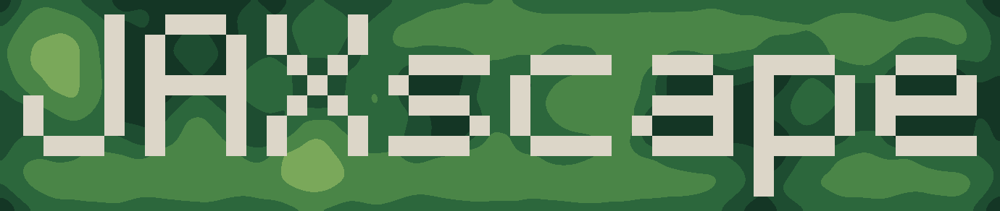
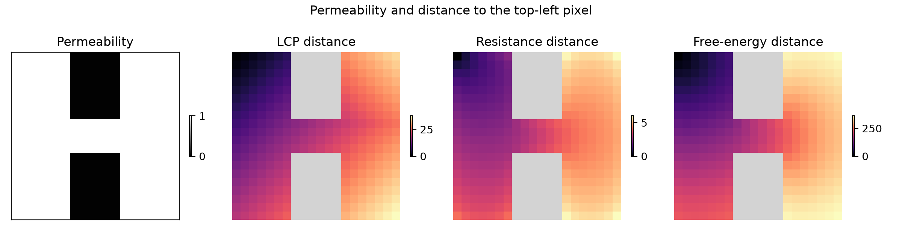

<!-- docs:exclude-start -->
[](https://github.com/vboussange/jaxscape/actions/workflows/run_tests.yml)
[](https://github.com/vboussange/jaxscape/actions/workflows/build_docs.yml)
[](https://doi.org/10.5281/zenodo.15267703)
<!-- docs:exclude-end -->

<div align="center">
  
  <!-- <p><sub>The quality and permeability rasters are uniform, except on the title: a barrier with no habitat quality and low permeability. <code>jaxscape.SensitivityAnalysis</code> computes the elasticity of connectivity to the permeability of each pixel. The corridors through the letters with the highest elasticity are made permeable (lime) in batches, and the elasticity is recomputed after each batch. Habitat is shaded by its elasticity. -->
  <p><sub>Generated by <a href="docs/examples/logo/make_logo.py"><code>make_logo.py</code></a>.</sub></p>
</div>
<!-- [](https://pypi.org/project/jaxscape)
[](https://pypi.org/project/jaxscape) -->

---

JAXScape is a minimal JAX library for connectivity analysis at scale. It provides the building blocks of a connectivity analysis workflow:

- differentiable and GPU-accelerated graph distance metrics
- differentiable raster-to-graph and graph-to-raster mappings
- moving-window utilities for connectivity analyses of large rasters

JAXScape runs on CPUs, GPUs and TPUs through JAX. Its computations are differentiable, for sensitivity analysis and optimization, and it implements its own linear solvers and differentiation rules where JAX provides none.

## Why JAXScape?

<!-- Update this section from each published benchmark run: docs/agents/benchmark-table.md -->

JAXScape unifies the main connectivity analysis frameworks in one minimal stack, with best-in-class performance.

| Package | Effective distance: least-cost path | Effective distance: resistance | Effective distance: free energy | Connected habitat | Movement corridors and pinch points |
| --- | :-: | :-: | :-: | :-: | :-: |
| **JAXScape** | ✓ | ✓ | ✓ | ✓ | ✓ |
| [Circuitscape.jl](https://github.com/Circuitscape/Circuitscape.jl) |  | ✓ |  |  | ✓ |
| [Omniscape.jl](https://github.com/Circuitscape/Omniscape.jl) |  |  |  |  | ✓ |
| [gdistance](https://cran.r-project.org/package=gdistance) | ✓ | ✓ |  |  | ✓ |
| [ConScape.jl](https://conscape.org) | ✓ |  | ✓ | ✓ | ✓ |
| [skimage.graph.MCP](https://scikit-image.org/docs/stable/api/skimage.graph.html#skimage.graph.MCP) | ✓ |  |  |  |  |
| [Graphab](https://thema.umlp.fr/productions/software/graphab/en/home.html) | ✓ | ✓ |  | ✓ | ✓ |
| [Conefor](http://www.conefor.org/) |  |  |  | ✓ |  |
| [eco-connectivity](https://github.com/csiro/connectivity) |  |  |  | ✓ |  |
| [EcoScape](https://github.com/ecoscape-earth/ecoscape-connectivity) |  |  |  |  | ✓ |
| [samc](https://cran.r-project.org/package=samc) |  |  |  |  | ✓ |
| **Speed-up of JAXScape over the fastest other package** | 1.2x over skimage.graph.MCP | 24x over Circuitscape.jl | 2.2x over ConScape.jl | 0.6x over Graphab (on habitat patches) | 13x over EcoScape |

Speed-up: runtime of the fastest other package divided by that of JAXScape on one GPU, on the largest raster both ran, in the benchmark of JAXScape 0.0.16. The [benchmark page](https://vboussange.github.io/jaxscape/benchmark/) of the [documentation](https://vboussange.github.io/jaxscape/) details the comparison.

[ilg-toolkit](https://github.com/vboussange/ilg-toolkit) is the layer on top of JAXScape for **inverse landscape genetics**, which seeks to infer landscape permeability from geolocated molecular data. It integrates with the JAX scientific machine learning (SciML) ecosystem, including [Equinox](https://github.com/patrick-kidger/equinox) and [Flax](https://github.com/google/flax), whose layers can be used to build high-capacity models that map landscape features to permeability. [ResistanceGA](https://github.com/wpeterman/ResistanceGA) (genetic algorithm) and [radish](https://github.com/nspope/radish) (gradient-based optimization) address the same problem, without GPU acceleration or integration with a machine learning ecosystem.

## Installation

```console
uv add jaxscape
```

The default installation is CPU-only. For NVIDIA GPUs, use `uv add 'jaxscape[cuda]'`, or install JAX following the [official JAX installation guide](https://jax.readthedocs.io/en/latest/installation.html). JAXScape will automatically use the JAX backend you have configured.

Least-cost path and resistance distances on rasters work with the default installation. Free-energy distances on large rasters, and resistance or free-energy distances on large graphs that are not rasters, such as networks of habitat patches, need an optional linear solver. See the [linear solver page](https://vboussange.github.io/jaxscape/api/linear_solvers).

## Quick start

**1. Download sample data**

```bash
curl -sL https://github.com/vboussange/jaxscape/releases/download/v0.0.6/data.zip -o data.zip && unzip -q data.zip && rm data.zip
```

**2. Run the analysis**

```python
import jax.numpy as jnp
import matplotlib.pyplot as plt
import numpy as np
from jaxscape import FreeEnergyDistance, GridGraph, LCPDistance, ResistanceDistance

permeability = jnp.array(
    np.loadtxt("data/permeability.csv", delimiter=","), dtype=jnp.float32
) + 0.01
barriers = np.asarray(permeability <= 0.1)

# Symmetric conductances are the mean permeability of neighboring cells.
grid = GridGraph(grid=permeability, fun=lambda x, y: (x + y) / 2)

# Compute distances from the top-left pixel to every other pixel.
source = grid.coord_to_index(jnp.array([0]), jnp.array([0]))
distances = {
    "Least-cost path": LCPDistance()(grid, sources=source),
    "Resistance": ResistanceDistance()(grid, sources=source),
    r"Free energy, $\theta = 0.03$": FreeEnergyDistance(theta=0.03)(grid, sources=source),
}

distance_cmap = plt.cm.magma.copy()
distance_cmap.set_bad(color="lightgray")

fig, axs = plt.subplots(1, 4, figsize=(12, 3.3))

permeability_im = axs[0].imshow(permeability, cmap="gray", vmin=0, vmax=1)
axs[0].set_xticks([])
axs[0].set_yticks([])
for spine in axs[0].spines.values():
    spine.set_visible(True)
axs[0].set_title("Permeability")
fig.colorbar(permeability_im, ax=axs[0], shrink=0.2)

for ax, (title, dist_to_node) in zip(axs[1:], distances.items()):
    # Convert from node values to a 2D array and hide barrier cells
    dist_array = np.asarray(grid.node_values_to_array(dist_to_node.ravel()))
    dist_array = np.ma.masked_where(barriers, dist_array)

    # Plotting
    im = ax.imshow(dist_array, cmap=distance_cmap)
    ax.axis("off")
    ax.set_title(title)
    fig.colorbar(im, ax=ax, shrink=0.2)

fig.suptitle("Distance from the top-left pixel")
plt.tight_layout()
plt.show()
```

`theta` is the inverse temperature of the free-energy distance: larger values
bring it closer to the least-cost distance. The
[solver guide](https://vboussange.github.io/jaxscape/api/linear_solvers/)
covers solver choices for other graphs and larger landscapes.

<div align="center"></div>

These distances are differentiable: `jax.grad` of a scalar function of them,
such as their mean, gives its derivative with respect to the permeability of
every pixel. The
[distance calculation example](https://vboussange.github.io/jaxscape/examples/distance_calculation/distance_calculation/)
maps this derivative.

<!-- docs:exclude-start -->
## Documentation

The documentation is at [https://vboussange.github.io/jaxscape](https://vboussange.github.io/jaxscape/).

<!-- docs:exclude-end -->

## Contributing

See [CONTRIBUTING.md](CONTRIBUTING.md).

## Benchmarking

JAXScape includes a benchmark workspace that profiles JAXScape's own
implementations and compares them with other landscape connectivity software.
The [benchmark page](https://vboussange.github.io/jaxscape/benchmark/) of the
documentation describes the tasks and publishes the results. To reproduce the
benchmark or run it on your own CPU or GPU, follow the instructions in
[`benchmark/README.md`](benchmark/README.md).

## License

`jaxscape` is distributed under the terms of the [MIT](https://spdx.org/licenses/MIT.html) license.

## Citation

If you use JAXScape in your research, please cite:

```bibtex
@software{jaxscape2024,
  author = {Boussange, Victor},
  title = {JAXScape: A minimal JAX library for connectivity modelling at scale},
  year = {2025},
  doi = {10.5281/zenodo.15267703},
  url = {https://github.com/vboussange/jaxscape}
}
```
