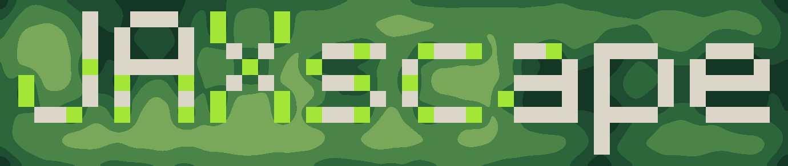

[](https://github.com/vboussange/jaxscape/actions/workflows/run_tests.yml)
[](https://github.com/vboussange/jaxscape/actions/workflows/build_docs.yml)
[](https://doi.org/10.5281/zenodo.15267703)

<div align="center">
  
</div>
<!-- [](https://pypi.org/project/jaxscape)
[](https://pypi.org/project/jaxscape) -->

---

JAXScape is a minimal JAX library for connectivity analysis at scales. It provide key utilities to build your own connectivity analysis workflow, including

- differentiable and GPU-accelerated graph distance metrics
- differentiable raster to graph and graph to raster mappings
- moving window utilities for implementing large-scale connectivity analysis pipelines

JAXScape implements custom methods and leverages JAX's capabilities to accelerate distance computations on CPUs/GPUs/TPUs, while ensuring differentiability across the codebase for awesome sensitivity analysis and optimization.

## Why JAXScape?

The [benchmark](https://vboussange.github.io/jaxscape/benchmark/) compares JAXScape 0.0.16 with the connectivity software that ecologists use, on rasters of up to `8192 x 8192` pixels, with JAXScape on an RTX 3090 GPU and every tool on the same 16 CPU cores.

- **Resistance distance.** On a `4096 x 4096` raster, JAXScape computes the resistance distances among 32 sites in 5.5 s on the GPU, in float32 with a largest relative error of 3e-3: `24x` faster than [`Circuitscape.jl`](https://github.com/Circuitscape/Circuitscape.jl) with `cholmod` (130 s), `113x` faster than with `cg+amg` (622 s), and `309x` faster than [`gdistance`](https://cran.r-project.org/package=gdistance) (1,696 s). At `8192 x 8192`, JAXScape 0.0.16 runs out of GPU memory, and takes 308 s on the CPU, against 646 s for Circuitscape.jl with `cholmod`.
- **Corridors.** On an `8192 x 8192` raster, JAXScape maps the sensitivity of connectivity to the permeability of each pixel in 264 s on the GPU, with the windows of Omniscape's Maryland example. [`Omniscape.jl`](https://github.com/Circuitscape/Omniscape.jl) computes its normalized current, a related map, in 2,751 s.


## Installation

```console
uv add jaxscape
```

The default installation is CPU-only. For NVIDIA GPUs, use `uv add 'jaxscape[cuda]'`, or install JAX following the [official JAX installation guide](https://jax.readthedocs.io/en/latest/installation.html). JAXScape will automatically use the JAX backend you have configured.

Graphs other than grids and large free-energy computations may need an optional linear solver; see the [linear solver page](https://vboussange.github.io/jaxscape/api/linear_solvers).

## Quick start

**1. Download sample data**

```bash
curl -sL https://github.com/vboussange/jaxscape/releases/download/v0.0.6/data.zip -o data.zip && unzip -q data.zip && rm data.zip
```

**2. Run the analysis**

```python
import jax.numpy as jnp
import matplotlib.pyplot as plt
import numpy as np
from jaxscape import FreeEnergyDistance, GridGraph, LCPDistance, ResistanceDistance

permeability = jnp.array(
    np.loadtxt("data/permeability.csv", delimiter=","), dtype=jnp.float32
) + 0.01
barriers = np.asarray(permeability <= 0.1)

# Symmetric conductances are the mean permeability of neighboring cells.
grid = GridGraph(grid=permeability, fun=lambda x, y: (x + y) / 2)

# Compute distances from the top-left pixel to every other pixel.
source = grid.coord_to_index(jnp.array([0]), jnp.array([0]))
distances = {
    "LCP distance": LCPDistance()(grid, sources=source),
    "Resistance distance": ResistanceDistance()(grid, sources=source),
    "Free-energy distance": FreeEnergyDistance(theta=0.03)(grid, sources=source),
}

distance_cmap = plt.cm.magma.copy()
distance_cmap.set_bad(color="lightgray")

fig, axs = plt.subplots(1, 4, figsize=(12, 3.3))

permeability_im = axs[0].imshow(permeability, cmap="gray", vmin=0, vmax=1)
axs[0].set_xticks([])
axs[0].set_yticks([])
for spine in axs[0].spines.values():
    spine.set_visible(True)
axs[0].set_title("Permeability")
fig.colorbar(permeability_im, ax=axs[0], shrink=0.2)

for ax, (title, dist_to_node) in zip(axs[1:], distances.items()):
    # Convert from node values to a 2D array and hide barrier cells
    dist_array = np.asarray(grid.node_values_to_array(dist_to_node.ravel()))
    dist_array = np.ma.masked_where(barriers, dist_array)

    # Plotting
    im = ax.imshow(dist_array, cmap=distance_cmap)
    ax.axis("off")
    ax.set_title(title)
    fig.colorbar(im, ax=ax, shrink=0.2)

fig.suptitle("Permeability and distance to the top-left pixel")
plt.tight_layout()
plt.show()
```

`theta` is the inverse temperature of the free-energy distance: larger values
bring it closer to the least-cost distance. The
[solver guide](https://vboussange.github.io/jaxscape/api/linear_solvers/)
covers solver choices for other graphs and larger landscapes.

<div align="center"></div>

But what's really cool about `JAXscape` is that you can autodiff through thoses distances! Check out the [documentation](#documentation) to learn about applications and more!


## Documentation

Comprehensive documentation is available at [https://vboussange.github.io/jaxscape](https://vboussange.github.io/jaxscape/)

## Contributing

See [CONTRIBUTING.md](CONTRIBUTING.md) for setup instructions, code contributions,
and documentation previews.

## Benchmarking

The [`benchmark`](benchmark/README.md) directory holds a benchmark, pinned to a
JAXScape release, that compares JAXScape with the connectivity software of
ecologists on three ecological questions: isolation between populations,
habitat connectivity, and corridors. Its results are in the
[benchmark documentation](https://vboussange.github.io/jaxscape/benchmark/).

## License

`jaxscape` is distributed under the terms of the [MIT](https://spdx.org/licenses/MIT.html) license.

## Citation

If you use JAXScape in your research, please cite:

```bibtex
@software{jaxscape2024,
  author = {Boussange, Victor},
  title = {JAXScape: A minimal JAX library for connectivity modelling at scale},
  year = {2025},
  doi = {10.5281/zenodo.15267703},
  url = {https://github.com/vboussange/jaxscape}
}
```
