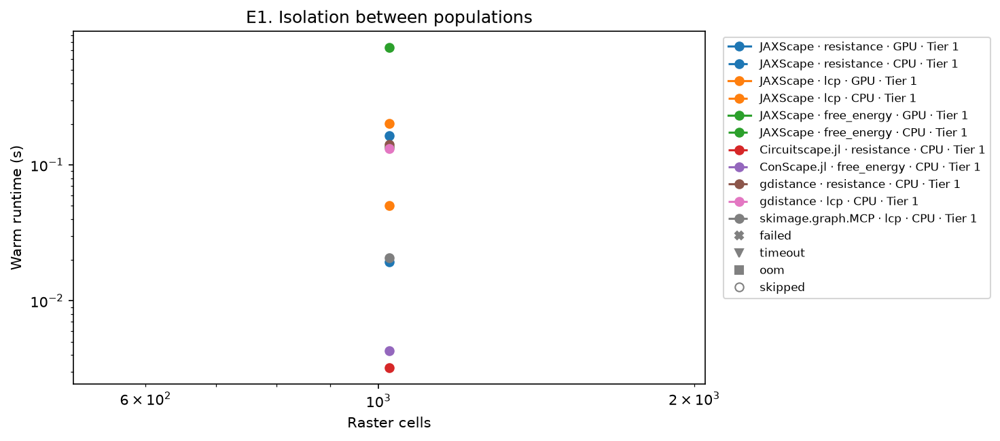
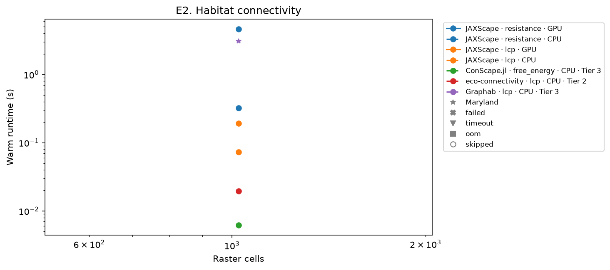
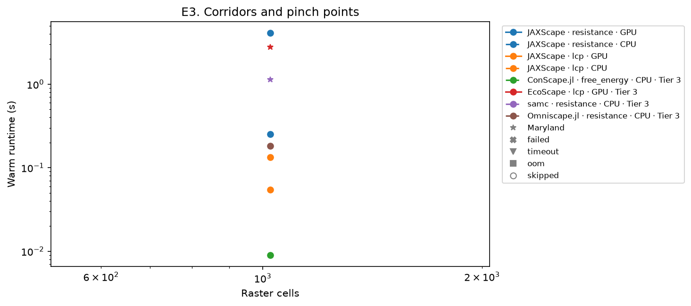
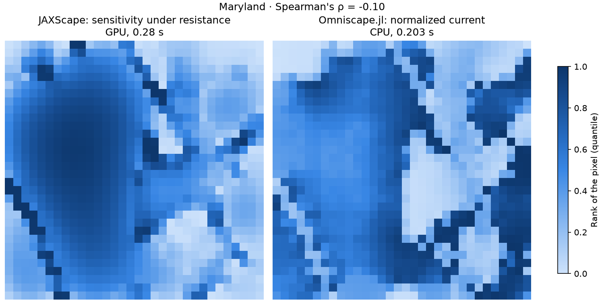
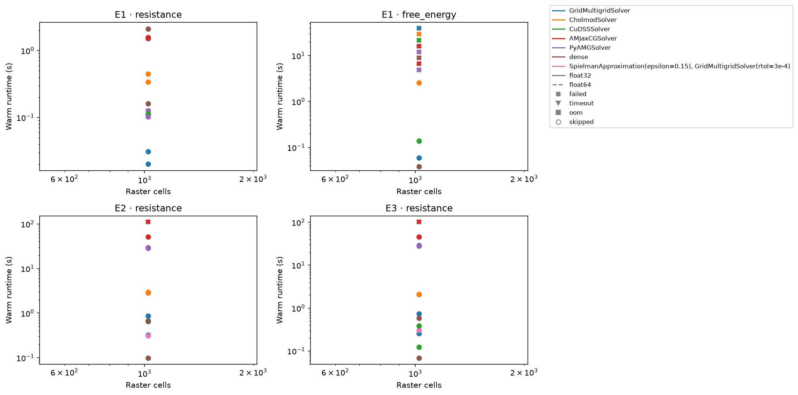

# Benchmark

This page compares JAXScape 0.0.16 with the software that ecologists use for connectivity analysis, on three questions from ecology. It is generated from the records of the run `smoke`, started on 2026-11-10 on gpunode05. [`results.csv`](results.csv) lists every cell of the run.

## Questions

- **E1. Isolation between populations.** How isolated are two populations once the landscape between them is taken into account? *Quantity:* the effective distance $d_{ij}$ between focal habitat sites, which replaces Euclidean distance in dispersal kernels and in models of isolation by distance.
- **E2. Habitat connectivity.** How much habitat can each location functionally reach, and how much connected habitat does the landscape hold in total? *Quantity:* Hanski's connectivity $S_i = \sum_j K(d_{ij}) q_j$ at each location, and its quality-weighted total $\sum_i q_i S_i$, the quantity behind the equivalent connected area (ECA).
- **E3. Corridors and pinch points.** Which locations carry dispersal between habitat areas, so that losing their permeability would reduce connectivity the most? *Quantity:* a map of how much each location contributes to connectivity: the marginal sensitivity $\partial C / \partial p_k$ in JAXScape, and a flow, such as current, betweenness or visits, in the other tools.

Each comparison carries a tier of comparability. Tier 1 compares the same quantity, so that the error of each tool against a float64 reference measures its accuracy. Tier 2 compares the same quantity computed on another graph or with another kernel, and Tier 3 a related quantity that answers the same question; both report Spearman's rank correlation between maps. A runtime gap measures a speed-up only at Tier 1.

## Landscapes

Each synthetic case draws a Gaussian random field with a Gaussian covariance of correlation length 25 pixels, on a periodic grid with a fixed seed, and normalizes its ranks to [0, 1]. Quality equals the field where the field is at least 0.7, and 0 elsewhere, so that 30 % of the cells are habitat. Permeability is $10^{-2(1 - f)}$ for the field $f$, from 0.01 to 1, and resistance is its inverse. A larger raster covers a larger area at the same grain.

E2 and E3 also run on the Maryland case of Omniscape's example: the 2016 land cover of Frederick, Maryland, from the National Land Cover Database, 694 × 725 pixels of 30 m. Each class takes the resistance of Omniscape's reclassification table, medium- and high-intensity development are barriers, and forest, the classes of resistance 1, is habitat of quality 1.

## Comparison

Each cell runs in its own process, pinned to the cores of the environment table, with thread settings matched to them; XLA sizes its thread pools to these cores. A warm-up call comes first and compiles the code of tools that compile. The warm runtime is the median of the five timed calls that follow it, or the time of a single call when the warm-up takes more than five minutes. Every call redoes all work that depends on the landscape's values: graph assembly, factorization, multigrid hierarchy and solver state. A call stops after one hour. Within a configuration, rasters run from the smallest up, and after a failure, a timeout or running out of memory (`oom`), the configuration skips its larger rasters. A tool runs each setting of a small grid fixed in advance from its documentation: the tables list every setting, and the figures show, at each raster, the fastest setting that succeeds. In the figures, tools on the GPU are solid and on the CPU dashed, Maryland is a star, and rasters where no setting succeeds show a status along the top edge.

### E1. Isolation between populations

Each tool computes the distances among 32 sites drawn at random from the habitat cells with a fixed seed, across the whole raster: 496 pairs. Every tool builds the same graph: rook contiguity, and the resistance of an edge is the mean resistance of its two pixels. The agreement of a record is the largest relative error over the pairs against a float64 reference, computed once for each case and distance: a sparse direct solve with `CholmodSolver` for resistance and free energy, and Dijkstra's algorithm in SciPy for least-cost distances.

Agreement (largest relative error) of each configuration and raster, or the status of the cell; `missing` marks a cell whose reference is unavailable.

| Tool | Distance | Device | dtype | Solver | Tier | 32² |
| --- | --- | --- | --- | --- | --- | --- |
| JAXScape | resistance | GPU | float32 | GridMultigridSolver | 1 | 1.1e-05 |
| JAXScape | resistance | CPU | float32 | GridMultigridSolver | 1 | 5.8e-06 |
| JAXScape | lcp | GPU | float32 |  | 1 | 2.5e-07 |
| JAXScape | lcp | CPU | float32 |  | 1 | 2.4e-07 |
| JAXScape | free_energy | GPU | float64 | CuDSSSolver | 1 | 2.5e-14 |
| JAXScape | free_energy | CPU | float64 | CholmodSolver | 1 | 0.0e+00 |
| Circuitscape.jl | resistance | CPU | float64 | cg+amg | 1 | 8.9e-07 |
| Circuitscape.jl | resistance | CPU | float64 | cholmod | 1 | 4.6e-12 |
| ConScape.jl | free_energy | CPU | float64 |  | 1 | 1.3e-14 |
| gdistance | resistance | CPU | float64 |  | 1 | 7.3e-14 |
| gdistance | lcp | CPU | float64 |  | 1 | 8.1e-16 |
| skimage.graph.MCP | lcp | CPU | float64 |  | 1 | 3.3e-16 |

### E2. Habitat connectivity

JAXScape computes, in each call, the map of $\partial C / \partial q_i$ with `SensitivityAnalysis`, which equals $2 S_i$ for symmetric distances, and the total $C = \sum_i q_i S_i$ with `ConnectivityAnalysis`. Its windows have `dependency_range` 100 and `coarsening_factor` 0.2, which gives blocks of 21 pixels: Omniscape's `radius` and `block_size` in its Maryland example. Its proximity is the default, $e^{-r/25}$ with $r$ in equivalent pixels. The windowed analyses build their graphs with JAXScape's own edge rule: rook contiguity, and the conductance of an edge is the mean permeability of its two pixels. Free energy is left out of E2 and E3: its window query holds the dense inverse of the 40,401 pixels of a window, and in float64, the only precision that resolves its windows, one window ran out of the 24 GB of the GPU, and out of memory on the CPU after taking 300 GB. The agreement of another tool is Spearman's ρ between its map and JAXScape's map under the distance of its row, over the pixels where both maps are defined. ConScape.jl computes its maps under free energy on the whole raster, with targets at landmarks every 21 pixels and the kernel $e^{-d/25}$ on its free-energy distance $d$; JAXScape has no free-energy map to compare them with, and they are compared with its maps under least-cost distance, which ranks pairs of sites most like free energy at the $\theta$ of the run.

Agreement (Spearman's ρ) of each configuration and raster, or the status of the cell; `missing` marks a cell whose reference is unavailable.

| Tool | Distance | Device | dtype | Solver | Tier | Maryland | 32² |
| --- | --- | --- | --- | --- | --- | --- | --- |
| JAXScape | resistance | GPU | float32 | GridMultigridSolver |  | ok | ok |
| JAXScape | resistance | CPU | float32 | GridMultigridSolver |  | ok | ok |
| JAXScape | lcp | GPU | float32 |  |  | ok | ok |
| JAXScape | lcp | CPU | float32 |  |  | ok | ok |
| ConScape.jl | free_energy | CPU | float64 |  | 3 | 0.42 | 0.85 |
| eco-connectivity | lcp | CPU | float32 |  | 2 | 0.80 | 0.95 |
| Graphab | lcp | CPU | float64 |  | 3 | 0.70 | 0.39 |

### E3. Corridors and pinch points

JAXScape computes the map of $\partial C / \partial p_k$ with `SensitivityAnalysis`, with the windows and proximity of E2. The other tools map a flow, and the agreement of each is Spearman's ρ over pixels between its map and the map of JAXScape under the distance of its row, or under least-cost distance for ConScape.jl (see E2). Omniscape.jl computes its normalized current, the cumulative current divided by the flow potential, with the configuration of its Maryland example on JAXScape's windows, on a graph of eight neighbours.

Agreement (Spearman's ρ) of each configuration and raster, or the status of the cell; `missing` marks a cell whose reference is unavailable.

| Tool | Distance | Device | dtype | Solver | Tier | Maryland | 32² |
| --- | --- | --- | --- | --- | --- | --- | --- |
| JAXScape | resistance | GPU | float32 | GridMultigridSolver |  | ok | ok |
| JAXScape | resistance | CPU | float32 | GridMultigridSolver |  | ok | ok |
| JAXScape | lcp | GPU | float32 |  |  | ok | ok |
| JAXScape | lcp | CPU | float32 |  |  | ok | ok |
| ConScape.jl | free_energy | CPU | float64 |  | 3 | 0.68 | 0.85 |
| EcoScape | lcp | GPU | float32 |  | 3 | 0.91 | 0.94 |
| samc | resistance | CPU | float64 | direct | 3 | 0.13 | 0.58 |
| Omniscape.jl | resistance | CPU | float64 | cg+amg | 3 | -0.10 | 0.58 |
| Omniscape.jl | resistance | CPU | float64 | cholmod | 3 | -0.10 | 0.58 |

On Maryland, JAXScape's map of $\partial C / \partial p_k$ under resistance (GPU, 0.28 s) next to Omniscape.jl's normalized current (CPU, `cg+amg`, 0.203 s), each coloured by the rank of its pixels, with barriers in gray: Spearman's ρ = -0.10.

## Solvers

The solver view runs JAXScape with each of its linear solvers, in float32 and float64 on the GPU, on the cases of E1, E2 and E3, so that a user can trade speed for accuracy. `dense` is the dense solve (`solver=None`). Resistance runs on every question, and free energy on E1 alone, since it does not run on windows. Each cell runs like a cell of the comparison, except that a call stops after 15 minutes, and on fewer rasters: E1 on 256² and 1024², and E2 and E3 on 256², since exact windowed resistance takes about 23 minutes a call at 1024² with `GridMultigridSolver` in float32. The error of a cell, for E1, is the largest relative error over the pairs against the reference of E1, and for E2 and E3 the relative L2 error of the map $m$, $\lVert m - m_{\mathrm{ref}} \rVert_2 / \lVert m_{\mathrm{ref}} \rVert_2$, against the map of exact resistance in float64 with `CuDSSSolver` on the GPU, on the same tiles. In E2 and E3, `SpielmanApproximation(epsilon=0.15), GridMultigridSolver(rtol=3e-4)` is the setting of the comparison for resistance: Spielman's estimate of resistance, in float32.

Warm runtime and error of each solver, dtype and raster, or the status of the cell; `missing` marks a cell whose reference is unavailable.

| Question | Distance | dtype | Solver | 32² |
| --- | --- | --- | --- | --- |
| E1 | resistance | float32 | GridMultigridSolver | 0.0202 s · 1.1e-05 |
| E1 | resistance | float32 | CholmodSolver | 0.337 s · 1.0e-05 |
| E1 | resistance | float32 | CuDSSSolver | 0.11 s · 2.8e-05 |
| E1 | resistance | float32 | AMJaxCGSolver | 1.52 s · 2.9e-04 |
| E1 | resistance | float32 | PyAMGSolver | 0.127 s · 6.8e-06 |
| E1 | resistance | float32 | dense | 0.161 s · 8.6e-01 |
| E1 | resistance | float64 | GridMultigridSolver | 0.0312 s · 7.6e-14 |
| E1 | resistance | float64 | CholmodSolver | 0.446 s · 0.0e+00 |
| E1 | resistance | float64 | CuDSSSolver | 0.114 s · 1.8e-14 |
| E1 | resistance | float64 | AMJaxCGSolver | 1.57 s · 3.0e-04 |
| E1 | resistance | float64 | PyAMGSolver | 0.102 s · 5.9e-07 |
| E1 | resistance | float64 | dense | 2.09 s · 8.7e-14 |
| E1 | free_energy | float32 | GridMultigridSolver | failed |
| E1 | free_energy | float32 | CholmodSolver | failed |
| E1 | free_energy | float32 | CuDSSSolver | failed |
| E1 | free_energy | float32 | AMJaxCGSolver | failed |
| E1 | free_energy | float32 | PyAMGSolver | failed |
| E1 | free_energy | float32 | dense | failed |
| E1 | free_energy | float64 | GridMultigridSolver | 0.0594 s · 2.9e-14 |
| E1 | free_energy | float64 | CholmodSolver | 2.55 s · 3.3e-15 |
| E1 | free_energy | float64 | CuDSSSolver | 0.138 s · 3.8e-14 |
| E1 | free_energy | float64 | AMJaxCGSolver | failed |
| E1 | free_energy | float64 | PyAMGSolver | failed |
| E1 | free_energy | float64 | dense | 0.0384 s · 3.8e-14 |
| E2 | resistance | float32 | GridMultigridSolver | 0.322 s · 2.2e-05 |
| E2 | resistance | float32 | CholmodSolver | 2.85 s · 3.1e-07 |
| E2 | resistance | float32 | CuDSSSolver | 0.655 s · 1.1e-05 |
| E2 | resistance | float32 | AMJaxCGSolver | failed |
| E2 | resistance | float32 | PyAMGSolver | 28.7 s · 2.6e-05 |
| E2 | resistance | float32 | dense | 0.0978 s · 3.0e-06 |
| E2 | resistance | float32 | SpielmanApproximation(epsilon=0.15), GridMultigridSolver(rtol=3e-4) | 0.312 s · 1.0e-01 |
| E2 | resistance | float64 | GridMultigridSolver | 0.861 s · 4.4e-07 |
| E2 | resistance | float64 | CholmodSolver | 2.97 s · 2.4e-15 |
| E2 | resistance | float64 | CuDSSSolver | 0.675 s · 1.3e-15 |
| E2 | resistance | float64 | AMJaxCGSolver | 51.5 s · 1.2e-03 |
| E2 | resistance | float64 | PyAMGSolver | 29.4 s · 6.3e-07 |
| E2 | resistance | float64 | dense | 0.668 s · 5.1e-15 |
| E3 | resistance | float32 | GridMultigridSolver | 0.256 s · 2.4e-05 |
| E3 | resistance | float32 | CholmodSolver | 2.11 s · 1.2e-06 |
| E3 | resistance | float32 | CuDSSSolver | 0.124 s · 1.1e-05 |
| E3 | resistance | float32 | AMJaxCGSolver | failed |
| E3 | resistance | float32 | PyAMGSolver | 28.1 s · 1.5e-05 |
| E3 | resistance | float32 | dense | 0.0678 s · 5.8e-06 |
| E3 | resistance | float32 | SpielmanApproximation(epsilon=0.15), GridMultigridSolver(rtol=3e-4) | 0.302 s · 8.1e-02 |
| E3 | resistance | float64 | GridMultigridSolver | 0.739 s · 4.3e-07 |
| E3 | resistance | float64 | CholmodSolver | 2.09 s · 4.3e-15 |
| E3 | resistance | float64 | CuDSSSolver | 0.389 s · 2.4e-15 |
| E3 | resistance | float64 | AMJaxCGSolver | 45.9 s · 2.0e-03 |
| E3 | resistance | float64 | PyAMGSolver | 29 s · 1.8e-07 |
| E3 | resistance | float64 | dense | 0.586 s · 8.1e-15 |

## Environment

| Setting | Value |
| --- | --- |
| Host | gpunode05 |
| GPU | NVIDIA GeForce RTX 3090, driver 580.178.04, 24576 MiB |
| CPU | AMD EPYC 7742 64-Core Processor |
| Cores | 48-63 |
| Threads | `OMP_NUM_THREADS=16`, `OPENBLAS_NUM_THREADS=16`, `MKL_NUM_THREADS=16`, `JULIA_NUM_THREADS=16`, `RCPP_PARALLEL_NUM_THREADS=16` |
| Python | 3.13.5 |
| Packages | jaxscape 0.0.16, jax 0.12.0.1, jaxlib 0.12.0.1, numpy 2.5.4, scipy 1.18.1, scikit-image 0.26.0, ecoscape-connectivity 0.2.5, torch 2.15.0, eco-connectivity 2.5.0, Julia 1.13.3, Circuitscape 6.1.0, ConScape 0.3.0, JSON 1.13.4, NPZ 0.4.3, Omniscape 0.6.4, R 4.1.2, gdistance 1.6.5, samc 4.2.1, Graphab 3.0.8, Java 21.0.13 |
| Tools | JAXScape 0.0.16, ConScape.jl 0.3.0, EcoScape 0.2.5, samc 4.2.1, eco-connectivity 2.5.0, Graphab 3.0.8, Omniscape.jl 0.6.4, Circuitscape.jl 6.1.0, gdistance 1.6.5, skimage.graph.MCP 0.26.0 |

## Parameter mappings

The header comment of each adapter states how it maps the shared parameters onto its tool.

| Tool | Questions | Adapter | Mapping |
| --- | --- | --- | --- |
| JAXScape | E1, E2, E3 | `adapters/jaxscape.py` | JAXScape builds a `GridGraph` of the permeability raster with rook contiguity, the conductance of an edge being the harmonic mean of the permeabilities of its two pixels (`landscape.conductance`), so that its resistance is their mean resistance. Least-cost and free-energy distances take 1 / conductance as the edge cost, and the free energy takes the shared `theta`. E1 is a nodes-to-nodes query among the sites. E2 runs `SensitivityAnalysis(var="quality")` for the map and `ConnectivityAnalysis` for the total, and E3 `SensitivityAnalysis(var="permeability")`, with the shared `dependency_range` and `coarsening_factor`, the default proximity and the `batch_size` of the settings; these windowed analyses build their graphs with JAXScape's own edge rule, the mean permeability of the two pixels. The distance runs with the solver, the resistance `method` and the dtype of its settings, such as `GridMultigridSolver(rtol=3e-4)` (`dense` is the dense solve, `solver=None`), and every call builds the graphs and the solver states. |
| ConScape.jl | E1, E2, E3 | `adapters/conscape.jl` | ConScape.jl builds its graph with rook contiguity (`N4`), the affinity of an edge being the harmonic mean of the permeabilities of its two pixels (`AverageWeight`), as `landscape.conductance` gives, and the cost of an edge 1 / affinity (`Inv`). Its free energy takes the shared `theta`. E1 computes the free-energy distances among the sites, the targets of a `GridRSP`. ConScape's free-energy distance is directed, and the adapter returns the mean of the two directions between two sites, as JAXScape's `FreeEnergyDistance` does. E2 and E3 run on the whole raster, without windows, with targets at landmarks every b pixels (`coarse_graining`), each holding the quality of its block, where b is JAXScape's block size for the shared `dependency_range` and `coarsening_factor`: 21. E2 returns Hanski's S_i, the connected habitat of each pixel at source quality 1 (`connected_habitat`): the sum over landmarks of their quality times exp(-d / (dependency_range / 4)), exp(-d / 25), for the free-energy distance d to the landmark. E3 returns the quality-weighted betweenness (`betweenness_qweighted`). JAXScape has no free-energy map, and the configuration compares these maps with JAXScape's under least-cost distance. Free energy runs from a multiple of resistance distance, as theta falls to 0, to least-cost distance, as theta grows. On the synthetic raster of 256 pixels a side, for every theta from 1e-5 to 1.5e-2, it ranks the pairs of E1 sites as least-cost distance does (Spearman's rho 0.98 to 0.99, against 0.92 to 0.95 with resistance distance), and at theta 1.5e-4 ConScape's maps of E2 and E3 correlate more with JAXScape's under least-cost distance (rho 0.91 and 0.84) than under resistance distance (0.89 and 0.77). Every call rebuilds the affinities, the `Grid`, the landmarks and the `GridRSP`, with its sparse LU factorization, which runs on the BLAS threads of the cell. |
| EcoScape | E3 | `adapters/ecoscape.py` | EcoScape (`ecoscape-connectivity`) simulates the repopulation of the habitat, the pixels of quality > 0, from seeds drawn at random in it, and maps its flow: the gradient of the repopulation with respect to the permeability of each pixel, times that permeability. Its edge rule is its own: at each step, individuals spread to the 8 neighbours of a pixel, survive a coin toss, and are multiplied by the permeability of their destination. The dispersal distance is the shared `dependency_range`, in pixels, which is also the border of its tiles and their padding, so that its map covers the raster. Quality enters only as habitat. The other settings are EcoScape's defaults: 400 simulations, 4 seeds per square of side 2 `dependency_range` + 1, tiles of 1000 pixels and no gap crossing, with the `batch_size` of the settings and a fixed random seed. EcoScape tiles a raster through GeoTIFFs only: every call writes the habitat and permeability to /dev/shm, runs on the GPU, and reads back the flow, which EcoScape writes with its connectivity. Its map is compared with JAXScape's under least-cost distances: repopulation follows the most permeable neighbour, the maximum over neighbours, as a least-cost path does. |
| samc | E3 | `adapters/samc.R` | samc builds a spatial absorbing Markov chain on the resistance raster, 1 / permeability, with 4 neighbours (rook contiguity) and the transition function 1 / mean(x): an individual moves to a neighbour in proportion to the harmonic mean of the permeabilities of the two pixels, `landscape.conductance`, and barriers, of permeability 0, are left out of the chain. The absorption of every pixel is (4 / `dependency_range`)^2 per step, so that an individual moves about `dependency_range` / 4 pixels before it is absorbed, the length over which JAXScape's default proximity decays. Individuals are released in proportion to quality, and the map is `visitation`: the expected number of visits to each pixel before absorption. The solver is samc's `method`, whose `direct` method factorizes the chain with a single thread. Every call builds the chain, on which samc caches its factorization. Its map is compared with JAXScape's under resistance distances: an absorbing random walk is the random walk behind resistance distance. |
| eco-connectivity | E2 | `adapters/eco_connectivity.py` | eco-connectivity computes the connectedness of each pixel i, with `option=1`: the sum over pixels j != i of exp(-d(i, j) / 25) q_j, divided by the same sum with quality 1 and every weight 1. Its numerator is Hanski's S_i; its denominator, the reach of an intact landscape, is constant away from the raster's edges. d is a least-cost distance over 8 neighbours, in which a step costs its length times the weight of the pixel it enters, here its resistance, 1 / permeability: the resistance raster is (r - 1) / (r_max - 1), and `max_cost` is r_max, the largest resistance. Quality is the condition raster. Barriers, of permeability 0, are masked, and the map is NaN there. Pixels are 1 km, so `lambdas=[25]` gives the kernel exp(-d/25) in pixels. The multi-resolution graph keeps the default `window_size`, `outer_window` and `window_mode`, and the default `levels` up to the first whose reach, `outer_window` times the level in pixels, covers `dependency_range`. `n_threads` is the number of cores of the cell. The tool reads GeoTIFFs: each call writes the two rasters to /dev/shm and computes the map from them. |
| Graphab | E2 | `adapters/graphab.py` | Graphab builds a graph of habitat patches, the clusters of habitat pixels (quality > 0) connected through 4 neighbours. Its links are least-cost paths between patches over 8 neighbours, in which a step costs its length times the mean resistance, 1 / permeability, of its two pixels (`extcost`), and barriers, of permeability 0, are no data. Links and graph keep the paths of cost up to `dependency_range` (`maxcost`, `threshold`, `topo=complete`), where the kernel falls to exp(-4). `d=25` and `p=exp(-1)` give the kernel exp(-d/25) on the cost of the shortest path in the graph, which adds the costs of crossing patches. The capacity a_I of a patch is its area in pixels. Each call computes the PC of the graph, the landscape total, and the flux F_I = sum over patches J != I of a_J exp(-d_IJ/25) (`beta=1`). The map is F_I + a_I, the patch analogue of Hanski's S_i, which adds the patch's own term that F leaves out, on the pixels of each patch, and NaN elsewhere. `-proc` is the number of cores of the cell. Graphab reads and writes files: each call writes the land and resistance rasters to /dev/shm, creates a new project from them, and reads the patches back. |
| Omniscape.jl | E3 | `adapters/omniscape.jl` | Omniscape.jl computes the normalized current of E3 with the configuration of its Maryland example: `radius` is the shared `dependency_range`, and `block_size` is `ceil(dependency_range * coarsening_factor)`, made odd as JAXScape makes its blocks, 21 pixels. Resistance is 1 / permeability, with the barriers, of permeability 0, as NoData, and the source strength of a pixel is its quality; on Maryland, these are the resistances of the example's reclassification table and the forest sources of its `source_from_resistance` with `r_cutoff` 1. The map is the cumulative current divided by the flow potential (`calc_normalized_current`, `calc_flow_potential`), compared with JAXScape's sensitivity under resistance, the distance of Omniscape's circuits. Omniscape keeps its other defaults: eight neighbours, the conductance of an edge being the mean permeability of its two pixels, divided by √2 on diagonals; artifact correction; double precision; the solver of the settings, with the windows solved in parallel on the Julia threads of the cell. Each call runs `run_omniscape` on arrays in memory, which redoes the sources, the targets and every window solve; it reads and writes no file, and only creates an empty project directory in /dev/shm. |
| Circuitscape.jl | E1 | `adapters/circuitscape.jl` | Circuitscape.jl computes the pairwise resistances among the E1 sites, in its `pairwise` scenario, with the permeability raster as the conductance of each cell. `connect_four_neighbors_only` gives rook contiguity, and `connect_using_avg_resistances` makes the resistance of an edge the mean resistance of its two cells, as `landscape.conductance` does. The solver is `cg+amg` or `cholmod`, in double precision, with `parallelize` on the Julia threads of the cell. Circuitscape.jl has no public in-memory API for this scenario: each call builds its `RasterData` in memory and runs the internals that `compute` runs after reading files (`build_problem`, `single_ground_all_pairs`), and writes only its table of resistances, to /dev/shm. Every call rebuilds the graph, the Laplacian and the AMG hierarchy or Cholesky factor. |
| gdistance | E1 | `adapters/gdistance.R` | gdistance builds a transition layer of the resistance raster, 1 / permeability, with 4 neighbours (rook contiguity) and the transition function 1 / mean(x): the conductance between two pixels is the reciprocal of their mean resistance, `landscape.conductance`. Resistance distances are `commuteDistance` divided by the volume of the graph, the sum of its conductances in both directions, and least-cost distances are `costDistance`, whose edge cost is 1 / conductance. Pixels have side 1, so `geoCorrection` leaves the layer unchanged and is left out. Every call builds the transition layer, whose conductances depend on the resistance. |
| skimage.graph.MCP | E1 | `adapters/skimage.py` | skimage.graph.MCP_Geometric finds least-cost paths on the resistance raster, 1 / permeability, with rook contiguity (`fully_connected=False`). The cost of a step is the mean resistance of its two pixels, 1 / `landscape.conductance`, the edge cost of JAXScape. Each call builds the MCP object, and searches from each site until it reaches all the others. |

## Excluded tools

| Tool | Reason |
| --- | --- |
| Linkage Mapper | Needs ArcGIS. |
| Circuitscape 4 | Superseded by Circuitscape.jl. |
| GFlow | Abandoned. |
| UNICOR | Has no release and no licence. |
| Conefor | Starts from a patch graph. |
| Makurhini | Starts from vector patches. |
| GRASS `r.cost` | Duplicates least-cost paths. |
| WhiteboxTools | Duplicates least-cost paths. |
| `terra` | Duplicates least-cost paths. |
| DiffiScape | Wraps JAXScape. |
| circuitscaper | Wraps Circuitscape.jl. |
| enerscape | Computes no connectivity from resistance. |
| Zonation | Computes no connectivity from resistance. |
| MSPA | Computes no connectivity from resistance. |
| ResistanceGA | Moves to `ilg-toolkit` with inverse landscape genetics. |
| radish | Moves to `ilg-toolkit` with inverse landscape genetics. |
