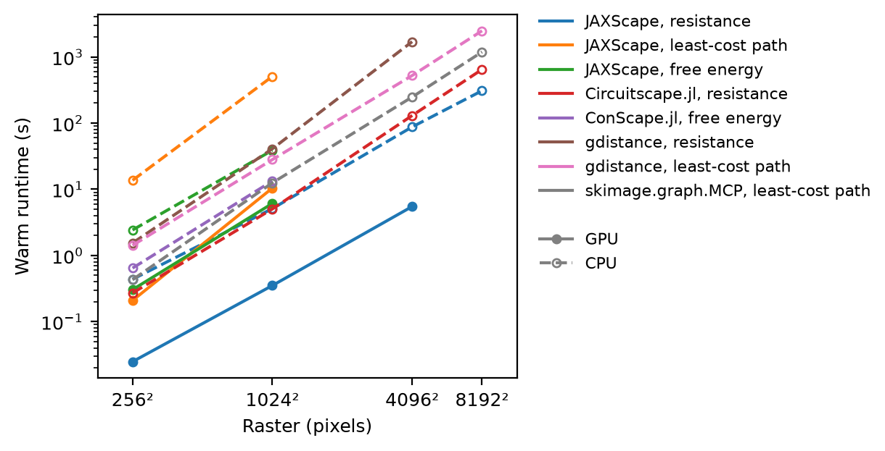
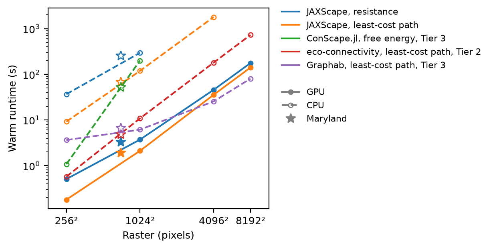
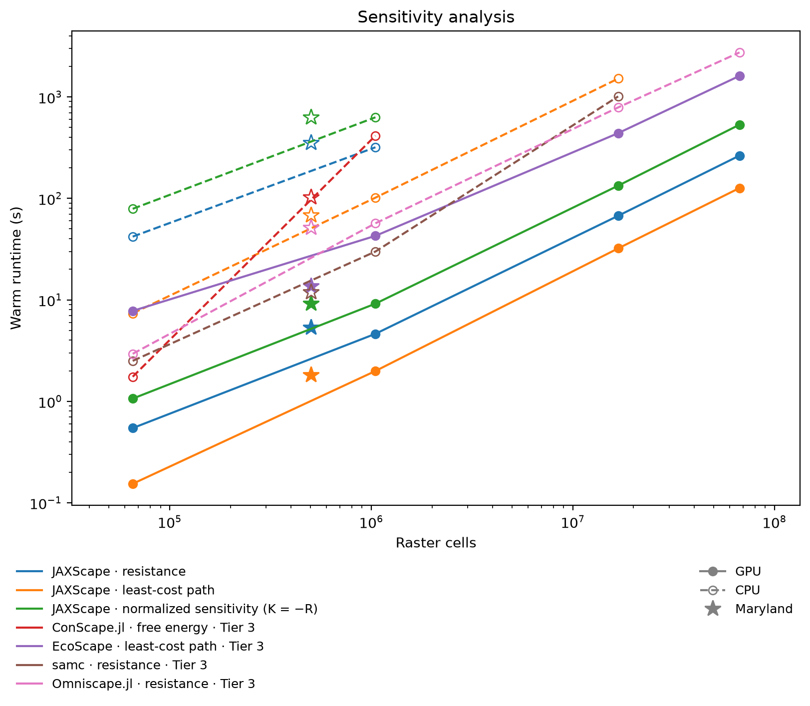
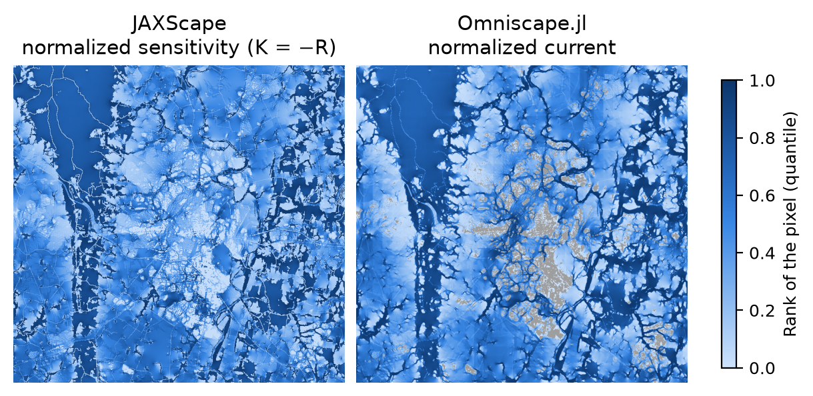
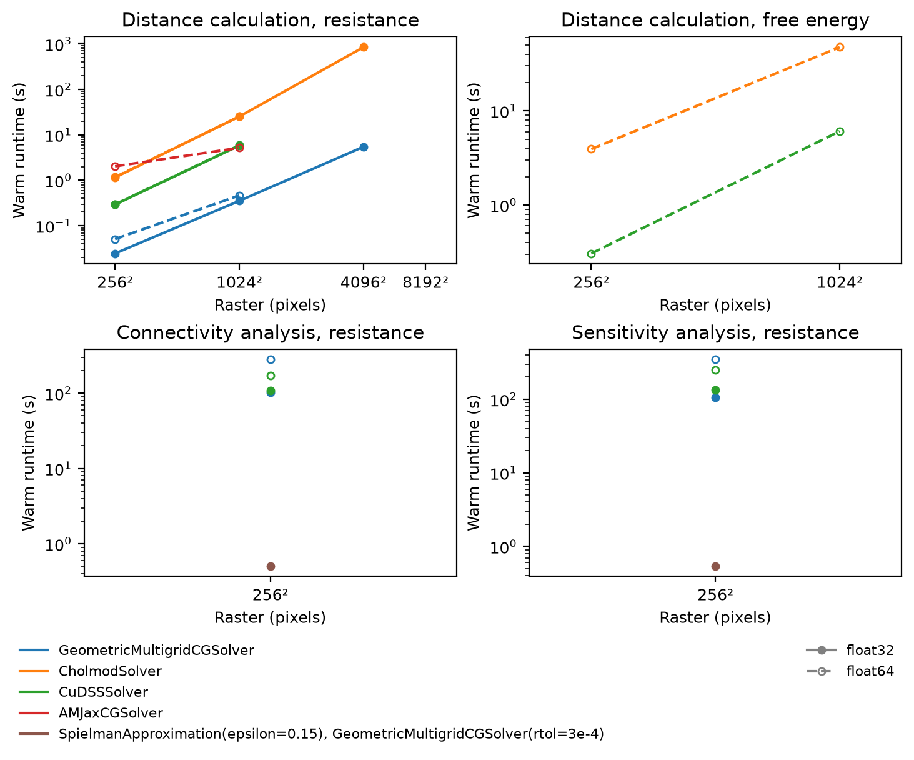
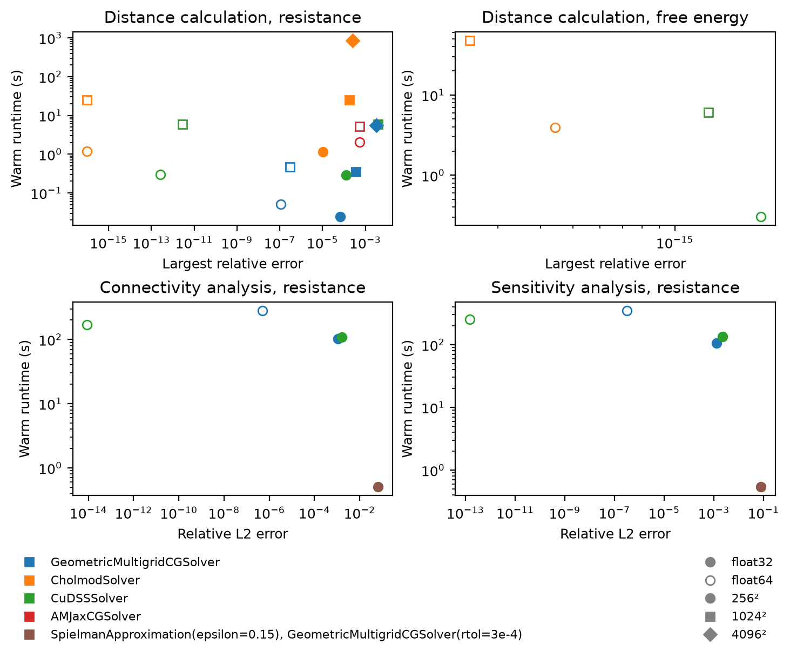

# Benchmark

This page compares JAXScape with the software that ecologists use for connectivity analysis on three questions: the distance calculation, the connectivity analysis and the sensitivity analysis. For each tool, it reports the warm runtime and the agreement of the results with a reference. The last section compares the linear solvers of JAXScape. [`records.csv`](records.csv) holds the record of every cell of the run: one setting of a tool on one raster.

## Setup

### Hardware and software

- **GPU**: one NVIDIA GeForce RTX 3090 with 24576 MiB, driver 580.178.04, CUDA 13.0.
- **CPU**: 16 cores of an AMD EPYC 7742 64-Core Processor, under Ubuntu 22.04.5 LTS. Each cell runs in its own process, pinned to these cores, with 16 threads for OpenMP, BLAS, Julia and R; XLA sizes its thread pools to the same cores.
- **Languages and libraries**: Python 3.13.5, JAX 0.12.0.1, jaxlib 0.12.0.1, PyTorch 2.15.0, Julia 1.13.3, R 4.1.2, Java 21.0.13.

### Tools

| Tool | Version | Questions |
| --- | --- | --- |
| JAXScape | 0.0.16 | distance calculation, connectivity analysis, sensitivity analysis |
| Circuitscape.jl | 6.1.0 | distance calculation |
| ConScape.jl | 0.3.0 | distance calculation, connectivity analysis, sensitivity analysis |
| gdistance | 1.6.5 | distance calculation |
| skimage.graph.MCP | 0.26.0 | distance calculation |
| EcoScape | 0.2.5 | sensitivity analysis |
| samc | 4.2.1 | sensitivity analysis |
| eco-connectivity | 2.5.0 | connectivity analysis |
| Graphab | 3.0.8 | connectivity analysis |
| Omniscape.jl | 0.6.4 | sensitivity analysis |

The run used JAXScape 0.0.16, whose solvers the page names as JAXScape 0.0.18 does: `GridMultigridSolver` as `GeometricMultigridCGSolver`.

??? note "Parameter mapping of each tool"

    | Tool | Mapping |
    | --- | --- |
    | JAXScape | JAXScape builds a `GridGraph` of the permeability raster with rook contiguity, the conductance of an edge being the harmonic mean of the permeabilities of its two pixels (`landscape.conductance`), so that its resistance is their mean resistance. The edge cost of least-cost path and free-energy distances is 1 / conductance, and the free-energy distance has the shared `theta`. The distance calculation is a nodes-to-nodes query among the sites. The connectivity analysis runs `SensitivityAnalysis(var="quality")` for the map and `ConnectivityAnalysis` for the landscape total, sum_i q_i S_i, and the sensitivity analysis runs `SensitivityAnalysis(var="permeability")`, with the shared `dependency_range` and `coarsening_factor`, the default proximity and the `batch_size` of the settings; these windowed analyses build their graphs with JAXScape's own edge rule, the mean permeability of the two pixels. A `proximity` setting, a function of the distance in Python such as `lambda d: -d`, replaces the default proximity. With `normalized`, the map of the sensitivity analysis is the normalized sensitivity to resistance of the connectivity example: p^2 dC/dp divided by dC/dp on a landscape of permeability 1 and the same quality, and 0 where the latter is not positive, both computed in each call. The distance runs with the solver, the resistance `method` and the dtype of its settings, such as `GeometricMultigridCGSolver(rtol=3e-4)` (`dense` is the dense solve, `solver=None`), and every call builds the graphs and the solver states. |
    | Circuitscape.jl | Circuitscape.jl computes the pairwise resistances among the sites of the distance calculation, in its `pairwise` scenario, with the permeability raster as the conductance of each pixel. `connect_four_neighbors_only` gives rook contiguity, and `connect_using_avg_resistances` makes the resistance of an edge the mean resistance of its two pixels, as `landscape.conductance` does. The solver is `cg+amg` or `cholmod`, in double precision, with `parallelize` on the Julia threads of the cell. Circuitscape.jl has no public in-memory API for this scenario: each call builds its `RasterData` in memory and runs the internals that `compute` runs after reading files (`build_problem`, `single_ground_all_pairs`), and writes only its table of resistances, to /dev/shm. Every call rebuilds the graph, the Laplacian and the AMG hierarchy or Cholesky factor. |
    | ConScape.jl | ConScape.jl builds its graph with rook contiguity (`N4`), the affinity of an edge being the harmonic mean of the permeabilities of its two pixels (`AverageWeight`), as `landscape.conductance` gives, and the cost of an edge 1 / affinity (`Inv`). Its free-energy distance has the shared `theta`. The distance calculation computes the free-energy distances among the sites, the targets of a `GridRSP`. ConScape's free-energy distance is directed, and the adapter returns the mean of the two directions between two sites, as JAXScape's `FreeEnergyDistance` does. The connectivity and sensitivity analyses run on the whole raster, without windows, with targets at landmarks every b pixels (`coarse_graining`), each holding the quality of its block, where b is the `block_size` of the windows, JAXScape's block size: 21. The connectivity analysis returns Hanski's S_i, the connected habitat of each pixel at source quality 1 (`connected_habitat`): the sum over landmarks of their quality times exp(-d / (dependency_range / 4)), exp(-d / 25), for the free-energy distance d to the landmark. The sensitivity analysis returns the quality-weighted betweenness (`betweenness_qweighted`). JAXScape has no free-energy map, and the configuration compares these maps with JAXScape's under least-cost path distance (`compared_with = "lcp"`). The free-energy distance tends to a multiple of the resistance distance as theta tends to 0, and to the least-cost path distance as theta grows. On the synthetic raster of 256 pixels a side, for every theta from 1e-5 to 1.5e-2, the ranking of the pairs of sites of the distance calculation by free-energy distance agrees with their ranking by least-cost path distance (Spearman's ρ 0.98 to 0.99, against 0.92 to 0.95 with resistance distance), and at the shared theta, 0.01, ConScape's maps of connectivity and sensitivity correlate more with the maps of JAXScape's GPU cells under least-cost path distance (ρ 0.93 and 0.84) than under resistance distance (0.87 and 0.72). Every call rebuilds the affinities, the `Grid`, the landmarks and the `GridRSP`, with its sparse LU factorization, which runs on the BLAS threads of the cell. |
    | gdistance | gdistance builds a transition layer of the resistance raster, 1 / permeability, with 4 neighbours (rook contiguity) and the transition function 1 / mean(x): the conductance between two pixels is the reciprocal of their mean resistance, `landscape.conductance`. Resistance distances are `commuteDistance` divided by the volume of the graph, the sum of its conductances in both directions, and least-cost path distances are `costDistance`, whose edge cost is 1 / conductance. Pixels have side 1, so `geoCorrection` leaves the layer unchanged and is left out. Every call builds the transition layer, whose conductances depend on the resistance. |
    | skimage.graph.MCP | skimage.graph.MCP_Geometric finds least-cost paths on the resistance raster, 1 / permeability, with rook contiguity (`fully_connected=False`). The cost of a step is the mean resistance of its two pixels, 1 / `landscape.conductance`, the edge cost of JAXScape. Each call builds the MCP object, and searches from each site until it reaches all the others. |
    | EcoScape | EcoScape (`ecoscape-connectivity`) simulates the repopulation of the habitat, the pixels of quality > 0, from seeds drawn at random in it, and maps its flow: the gradient of the repopulation with respect to the permeability of each pixel, times that permeability. Its edge rule is its own: at each step, individuals spread to the 8 neighbours of a pixel, survive a coin toss, and are multiplied by the permeability of their destination. The dispersal distance is the shared `dependency_range`, in pixels, which is also the border of its tiles and their padding, so that its map covers the raster. Quality enters only as habitat. The other settings are EcoScape's defaults: 400 simulations, 4 seeds per square of side 2 `dependency_range` + 1, tiles of 1000 pixels and no gap crossing, with the `batch_size` of the settings and a fixed random seed. EcoScape tiles a raster through GeoTIFFs only: every call writes the habitat and permeability to /dev/shm, runs on the GPU, and reads back the flow, which EcoScape writes with its connectivity. Its map is compared with JAXScape's under least-cost path distances: repopulation follows the most permeable neighbour, the maximum over neighbours, as a least-cost path does. |
    | samc | samc builds a spatial absorbing Markov chain on the resistance raster, 1 / permeability, with 4 neighbours (rook contiguity) and the transition function 1 / mean(x): an individual moves to a neighbour in proportion to the harmonic mean of the permeabilities of the two pixels, `landscape.conductance`, and barriers, of permeability 0, are left out of the chain. The absorption of every pixel is (4 / `dependency_range`)^2 per step, so that an individual moves about `dependency_range` / 4 pixels before it is absorbed, the length over which JAXScape's default proximity decays. Individuals are released in proportion to quality, and the map is `visitation`: the expected number of visits to each pixel before absorption. The solver is samc's `method`, whose `direct` method factorizes the chain with a single thread. Every call builds the chain, on which samc caches its factorization. Its map is compared with JAXScape's under resistance distances: an absorbing random walk is the random walk behind resistance distance. |
    | eco-connectivity | eco-connectivity computes the connectedness of each pixel i, with `option=1`: the sum over pixels j != i of exp(-d(i, j) / 25) q_j, divided by the same sum with quality 1 and every weight 1. Its numerator is Hanski's S_i; its denominator, the reach of an intact landscape, is constant away from the raster's edges. d is a least-cost path distance over 8 neighbours, in which a step costs its length times the weight of the pixel it enters, here its resistance, 1 / permeability: the resistance raster is (r - 1) / (r_max - 1), and `max_cost` is r_max, the largest resistance. Quality is the condition raster. Barriers, of permeability 0, are masked, and the map is NaN there. Pixels are 1 km, so `lambdas=[25]` gives the proximity exp(-d/25) in pixels. The multi-resolution graph keeps the default `window_size`, `outer_window` and `window_mode`, and the default `levels` up to the first whose reach, `outer_window` times the level in pixels, covers `dependency_range`. `n_threads` is the number of cores of the cell. The tool reads GeoTIFFs: each call writes the two rasters to /dev/shm and computes the map from them. |
    | Graphab | Graphab builds a graph of habitat patches, the clusters of habitat pixels (quality > 0) connected through 4 neighbours. Its links are least-cost paths between patches over 8 neighbours, in which a step costs its length times the mean resistance, 1 / permeability, of its two pixels (`extcost`), and barriers, of permeability 0, are no data. Links and graph keep the paths of cost up to `dependency_range` (`maxcost`, `threshold`, `topo=complete`), where the proximity falls to exp(-4). `d=25` and `p=exp(-1)` give the proximity exp(-d/25) on the cost of the shortest path in the graph, which adds the costs of crossing patches. The capacity a_I of a patch is its area in pixels. Each call computes the equivalent connectivity EC of the graph, whose square, the sum over patches I and J of a_I a_J exp(-d_IJ/25), is the landscape total, and the flux F_I = sum over patches J != I of a_J exp(-d_IJ/25) (`beta=1`). The map is F_I + a_I, the patch analogue of Hanski's S_i, which adds the patch's own term that F leaves out, on the pixels of each patch, and NaN elsewhere. `-proc` is the number of cores of the cell. Graphab reads and writes files: each call writes the land and resistance rasters to /dev/shm, creates a new project from them, and reads the patches and EC back. |
    | Omniscape.jl | Omniscape.jl computes the normalized current of the sensitivity analysis with the configuration of its Maryland example: `radius` is the shared `dependency_range`, and `block_size` the side of JAXScape's blocks, `dependency_range * coarsening_factor` rounded up to an odd integer, 21 pixels. Resistance is 1 / permeability, with the barriers, of permeability 0, as NoData, and the source strength of a pixel is its quality; on Maryland, these are the resistances of the example's reclassification table and the forest sources of its `source_from_resistance` with `r_cutoff` 1. The map is the cumulative current divided by the flow potential (`calc_normalized_current`, `calc_flow_potential`), compared with JAXScape's normalized sensitivity to resistance, `resistance, K = -R, normalized`, which the connectivity example relates to it: resistance is the distance of Omniscape's circuits, every pair of habitat pixels has the same weight under the proximity K(R) = -R, as Omniscape injects the current of every source of a window, and the sensitivity is divided by its value on a landscape of permeability 1, as the current is divided by the flow potential. Omniscape keeps its other defaults: eight neighbours, the conductance of an edge being the mean permeability of its two pixels, divided by √2 on diagonals; artifact correction; double precision; the solver of the settings, with the windows solved in parallel on the Julia threads of the cell. Each call runs `run_omniscape` on arrays in memory, which redoes the sources, the targets and every window solve; it reads and writes no file, and only creates an empty project directory in /dev/shm. |

### Landscapes

- **Synthetic rasters** of 256², 1024², 4096² and 8192² pixels. The benchmark draws a Gaussian random field $f$ with a Gaussian covariance of correlation length 25 pixels, on a periodic grid with a fixed seed, and normalizes its ranks to [0, 1]. The habitat quality is $f$ where $f \geq 0.7$, and 0 elsewhere: 30 % of the pixels are habitat. The permeability is $10^{-2(1 - f)}$, from 0.01 to 1, and the resistance is its inverse. A larger raster covers a larger area at the same grain.
- **Maryland**, for the connectivity analysis and sensitivity analysis: the land cover of Omniscape's example, the 2016 National Land Cover Database of Frederick, Maryland, 694 × 725 pixels of 30 m. The resistance of each land-cover class is that of Omniscape's reclassification table; medium- and high-intensity development are barriers, and forest, the classes of resistance 1, is habitat of quality 1.

### Timing

- **Warm runtime**: the median time of the 5 timed calls of a cell, which follow a warm-up call that compiles the code of the tools that compile; the time of a single timed call when the warm-up call takes more than 5 min.
- **Work of a call**: every call redoes the work that depends on the landscape: graph assembly, factorization, multigrid hierarchy and solver state.
- **Speed-up of JAXScape** over a tool under a distance: the warm runtime of the tool divided by that of JAXScape on the GPU, each in its fastest setting on the largest synthetic raster that both completed, with JAXScape under the same distance in the distance calculation, and under the distance or label of the column "Compared with JAXScape under" in the connectivity and sensitivity analyses.
- **Time limit**: a call stops after 1 h, and in the section of the linear solvers of JAXScape after the time limit stated in its Method.
- **Status of a cell that did not complete**: `timeout` when a call exceeds its time limit, `oom` when a call runs out of memory, and `failed` on another error. A setting runs on the synthetic rasters from the smallest up, and is `skipped` on the rasters larger than one where it stopped; Maryland always runs.

### Comparability tiers

| Tier | The tool computes | Agreement measure |
| --- | --- | --- |
| 1 | the quantity of JAXScape, on the same graph | largest relative error with respect to a float64 reference |
| 2 | the quantity of JAXScape, on another graph or with another proximity | Spearman's ρ between the map of the tool and that of JAXScape |
| 3 | a related quantity that answers the same question | Spearman's ρ between the map of the tool and that of JAXScape |

Only at Tier 1 do the tool and JAXScape perform the same computation.

### Figures and tables

- **Figures of runtime**: each line passes through the warm runtimes of the fastest setting of a tool, distance and device that succeeded on each synthetic raster, solid on the GPU and dashed on the CPU; in the section of the linear solvers, a line is a solver and dtype, solid in float32 and dashed in float64. A star marks Maryland.
- **Tables**: an entry is the warm runtime and the agreement of a cell that succeeded, or the status of a cell that did not.

## Distance calculation

On the largest synthetic raster that JAXScape on the GPU and the other tool both completed, JAXScape is faster than every other tool, by a factor of 1.2 (skimage.graph.MCP, least-cost path distance) to 309 (gdistance, resistance distance). The largest relative error with respect to the float64 reference is at most 3.2e-03 for JAXScape, under resistance distance in float32, and at most 5.6e-05 for the other tools. On the GPU, JAXScape ran out of memory under least-cost path distance on 4096² and under resistance distance on 8192².

### Results

| Tool | Distance | Raster | Warm runtime of the tool | Warm runtime of JAXScape | Speed-up | Error of the tool | Error of JAXScape |
| --- | --- | --- | --- | --- | --- | --- | --- |
| Circuitscape.jl | resistance | 4096² | 130 s | 5.48 s | 24 | 1.9e-08 | 3.2e-03 |
| ConScape.jl | free energy | 1024² | 13.3 s | 6.1 s | 2.2 | 9.0e-16 | 1.3e-15 |
| gdistance | resistance | 4096² | 1700 s | 5.48 s | 309 | 2.5e-09 | 3.2e-03 |
| gdistance | least-cost path | 1024² | 28.1 s | 10.4 s | 2.7 | 4.5e-15 | 1.5e-06 |
| skimage.graph.MCP | least-cost path | 1024² | 12.5 s | 10.4 s | 1.2 | 3.4e-16 | 1.5e-06 |

??? note "Warm runtime and error of every setting on every raster"

    An entry without an error has no reference.

    | Tool | Distance | Setting | 256² | 1024² | 4096² | 8192² |
    | --- | --- | --- | --- | --- | --- | --- |
    | JAXScape | resistance | GPU, float32, GeometricMultigridCGSolver | 0.0249 s, error 6.8e-05 | 0.351 s, error 3.7e-04 | 5.48 s, error 3.2e-03 | oom |
    | JAXScape | resistance | CPU, float32, GeometricMultigridCGSolver | 0.437 s, error 7.5e-05 | 5.1 s, error 3.7e-04 | 87.4 s, error 1.2e-03 | 308 s |
    | JAXScape | least-cost path | GPU, float32 | 0.209 s, error 5.9e-07 | 10.4 s, error 1.5e-06 | oom | skipped |
    | JAXScape | least-cost path | CPU, float32 | 13.6 s, error 5.9e-07 | 506 s, error 1.5e-06 | timeout | skipped |
    | JAXScape | free energy | GPU, float64, CuDSSSolver | 0.304 s, error 1.6e-15 | 6.1 s, error 1.3e-15 |  |  |
    | JAXScape | free energy | CPU, float64, CholmodSolver | 2.42 s, error 0.0e+00 | 38.7 s, error 0.0e+00 |  |  |
    | Circuitscape.jl | resistance | CPU, float64, cg+amg | 0.401 s, error 6.2e-07 | 21.5 s, error 1.3e-06 | 622 s, error 5.6e-05 | 2210 s |
    | Circuitscape.jl | resistance | CPU, float64, cholmod | 0.271 s, error 8.7e-11 | 5.04 s, error 1.6e-09 | 130 s, error 1.9e-08 | 646 s |
    | ConScape.jl | free energy | CPU, float64 | 0.644 s, error 1.3e-15 | 13.3 s, error 9.0e-16 |  |  |
    | gdistance | resistance | CPU, float64 | 1.54 s, error 7.1e-13 | 40.9 s, error 1.5e-10 | 1700 s, error 2.5e-09 | failed |
    | gdistance | least-cost path | CPU, float64 | 1.42 s, error 1.4e-15 | 28.1 s, error 4.5e-15 | 522 s, error 7.6e-15 | 2480 s, error 1.1e-14 |
    | skimage.graph.MCP | least-cost path | CPU, float64 | 0.43 s, error 3.3e-16 | 12.5 s, error 3.4e-16 | 247 s, error 3.1e-16 | 1190 s, error 3.6e-16 |

### Settings that did not complete

| Tool | Distance | Setting | Raster | Status | Recorded reason |
| --- | --- | --- | --- | --- | --- |
| JAXScape | resistance | GPU, float32, GeometricMultigridCGSolver | 8192² | `oom` | allocation of 44.98 GiB failed |
| JAXScape | least-cost path | GPU, float32 | 4096² | `oom` | allocation of 14.00 GiB failed |
| JAXScape | least-cost path | CPU, float32 | 4096² | `timeout` | `a call exceeded 3600 s` |
| gdistance | resistance | CPU, float64 | 8192² | `failed` | `Error in h(simpleError(msg, call)) :` |

### Method

- **Quantity**: the distance $d_{ij}$ on a graph between habitat sites $i$ and $j$: resistance distance, least-cost path distance, and free-energy distance with $\theta = 0.01$. Ecologists use it in place of Euclidean distance in dispersal kernels and in models of isolation by distance.
- **Sites**: 32 sites drawn at random from the habitat pixels of the raster, 496 pairs.
- **Graph**: every tool builds the same graph: rook contiguity, with the mean resistance of two pixels as the resistance of their edge.
- **Rasters**: free-energy distance on 256² and 1024² alone.
- **Error**: the largest relative error over the pairs of sites with respect to a float64 reference computed on the CPU: the linear systems of resistance and free-energy distances are solved with JAXScape's `CholmodSolver`, and least-cost path distances are computed with Dijkstra's algorithm in SciPy.
- **Tier**: every tool is at Tier 1.

## Connectivity analysis

On the largest synthetic raster that JAXScape on the GPU and the other tool both completed, JAXScape is faster than ConScape.jl and eco-connectivity, by a factor of 5.2 (eco-connectivity) to 95 (ConScape.jl), and slower than Graphab (Tier 3), by a factor of 1.8. On those rasters, Spearman's ρ between the map of a tool and that of JAXScape ranges from 0.33 (Graphab) to 0.97 (eco-connectivity).

### Results

| Tool | Tier | Compared with JAXScape under | Raster | Warm runtime of the tool | Warm runtime of JAXScape | Speed-up | Spearman's ρ |
| --- | --- | --- | --- | --- | --- | --- | --- |
| ConScape.jl | 3 | least-cost path | 1024² | 199 s | 2.11 s | 95 | 0.91 |
| eco-connectivity | 2 | least-cost path | 8192² | 727 s | 141 s | 5.2 | 0.97 |
| Graphab | 3 | least-cost path | 8192² | 80.1 s | 141 s | 0.57 | 0.33 |

??? note "Warm runtime and Spearman's ρ of every setting on every raster"

    The maps of JAXScape are the references, and an entry of another tool without ρ has no map of JAXScape to compare with, or ρ is undefined.

    | Tool | Distance | Setting | 256² | Maryland | 1024² | 4096² | 8192² |
    | --- | --- | --- | --- | --- | --- | --- | --- |
    | JAXScape | resistance | GPU, float32, GeometricMultigridCGSolver(rtol=3e-4) | 0.506 s | 3.3 s | 3.71 s | 45.7 s | 176 s |
    | JAXScape | resistance | CPU, float32, GeometricMultigridCGSolver(rtol=3e-4) | 36.6 s | 254 s | 295 s | timeout | skipped |
    | JAXScape | least-cost path | GPU, float32 | 0.179 s | 1.93 s | 2.11 s | 35.5 s | 141 s |
    | JAXScape | least-cost path | CPU, float32 | 9.18 s | 67.3 s | 119 s | 1790 s | timeout |
    | ConScape.jl | free energy | CPU, float64 | 1.07 s, ρ = 0.93 | 52.5 s, ρ = 0.81 | 199 s, ρ = 0.91 |  |  |
    | eco-connectivity | least-cost path | CPU, float32 | 0.573 s, ρ = 0.98 | 4.83 s, ρ = 0.81 | 10.8 s, ρ = 0.97 | 180 s, ρ = 0.97 | 727 s, ρ = 0.97 |
    | Graphab | least-cost path | CPU, float64 | 3.63 s, ρ = -0.06 | 6.65 s, ρ = 0.80 | 6.12 s, ρ = 0.32 | 25.5 s, ρ = 0.38 | 80.1 s, ρ = 0.33 |

### Settings that did not complete

| Tool | Distance | Setting | Raster | Status | Recorded reason |
| --- | --- | --- | --- | --- | --- |
| JAXScape | resistance | CPU, float32, GeometricMultigridCGSolver(rtol=3e-4) | 4096² | `timeout` | `a call exceeded 3600 s` |
| JAXScape | least-cost path | CPU, float32 | 8192² | `timeout` | `a call exceeded 3600 s` |

### Method

- **Quantity**: Hanski's connectivity $S_i = \sum_j K(d_{ij})\, q_j$ of each pixel $i$, with the habitat quality $q_j$ of pixel $j$ and the proximity $K$, and its landscape total $C = \sum_i q_i S_i$, the square of the equivalent connected area.
- **JAXScape**: in each call, `SensitivityAnalysis` computes the map of $\partial C / \partial q_i$, equal to $2 S_i$ for a symmetric distance, and `ConnectivityAnalysis` computes $C$.
- **Windows**: windowed analyses with `dependency_range` 100 pixels and `coarsening_factor` 0.2, that is, blocks of 21 × 21 pixels, under the proximity $K(d) = e^{-d/25}$, with $d$ in equivalent pixels.
- **Graph**: rook contiguity, with the mean permeability of two pixels as the conductance of their edge.
- **Resistance distance**: `SpielmanApproximation(epsilon=0.15)` with `GeometricMultigridCGSolver(rtol=3e-4)`, the setting of the [connectivity example](../examples/connectivity_analysis/connectivity_analysis.ipynb), on tiles of up to 2,601 block centres.
- **Agreement**: Spearman's ρ between the map of a tool and the map of JAXScape on the GPU under the distance or label of the column "Compared with JAXScape under", over the pixels where both maps are defined.

## Sensitivity analysis

On the largest synthetic raster that JAXScape on the GPU and the other tool both completed, JAXScape is faster than every other tool, by a factor of 5.2 (Omniscape.jl) to 208 (ConScape.jl). On those rasters, Spearman's ρ between the map of a tool and that of JAXScape ranges from 0.55 (samc) to 0.94 (Omniscape.jl).

### Results

| Tool | Tier | Compared with JAXScape under | Raster | Warm runtime of the tool | Warm runtime of JAXScape | Speed-up | Spearman's ρ |
| --- | --- | --- | --- | --- | --- | --- | --- |
| ConScape.jl | 3 | least-cost path | 1024² | 414 s | 1.99 s | 208 | 0.78 |
| EcoScape | 3 | least-cost path | 8192² | 1610 s | 126 s | 13 | 0.75 |
| samc | 3 | resistance | 4096² | 1010 s | 67.3 s | 15 | 0.55 |
| Omniscape.jl | 3 | normalized sensitivity (K = −R) | 8192² | 2740 s | 532 s | 5.2 | 0.94 |

??? note "Warm runtime and Spearman's ρ of every setting on every raster"

    The maps of JAXScape are the references, and an entry of another tool without ρ has no map of JAXScape to compare with, or ρ is undefined.

    | Tool | Distance or label | Setting | 256² | Maryland | 1024² | 4096² | 8192² |
    | --- | --- | --- | --- | --- | --- | --- | --- |
    | JAXScape | resistance | GPU, float32, GeometricMultigridCGSolver(rtol=3e-4) | 0.544 s | 5.33 s | 4.62 s | 67.3 s | 264 s |
    | JAXScape | resistance | CPU, float32, GeometricMultigridCGSolver(rtol=3e-4) | 42 s | 353 s | 319 s | timeout | skipped |
    | JAXScape | least-cost path | GPU, float32 | 0.154 s | 1.82 s | 1.99 s | 32.1 s | 126 s |
    | JAXScape | least-cost path | CPU, float32 | 7.36 s | 67.9 s | 102 s | 1510 s | timeout |
    | JAXScape | normalized sensitivity (K = −R) | GPU, float32, GeometricMultigridCGSolver(rtol=3e-4) | 1.06 s | 9.15 s | 9.16 s | 133 s | 532 s |
    | JAXScape | normalized sensitivity (K = −R) | CPU, float32, GeometricMultigridCGSolver(rtol=3e-4) | 78.9 s | 631 s | 629 s | timeout | skipped |
    | ConScape.jl | free energy | CPU, float64 | 1.75 s, ρ = 0.84 | 102 s | 414 s, ρ = 0.78 |  |  |
    | EcoScape | least-cost path | GPU, float32 | 7.78 s, ρ = 0.76 | 13.7 s, ρ = 0.93 | 42.7 s, ρ = 0.75 | 439 s, ρ = 0.76 | 1610 s, ρ = 0.75 |
    | samc | resistance | CPU, float64, direct | 2.5 s, ρ = 0.74 | 11.9 s, ρ = 0.07 | 29.9 s, ρ = 0.59 | 1010 s, ρ = 0.55 | failed |
    | Omniscape.jl | resistance | CPU, float64, cg+amg | 2.94 s, ρ = 0.97 | 51.6 s, ρ = 0.80 | 56.8 s, ρ = 0.93 | 787 s, ρ = 0.93 | 2740 s, ρ = 0.94 |
    | Omniscape.jl | resistance | CPU, float64, cholmod | 5.16 s, ρ = 0.97 | 76 s, ρ = 0.80 | 117 s, ρ = 0.93 | 1720 s, ρ = 0.93 | timeout |

Rank of each pixel of Maryland in JAXScape's normalized sensitivity (K = −R) and in Omniscape.jl's normalized current (`cg+amg`), with barriers in gray. Spearman's ρ between the two maps is 0.80.

### Settings that did not complete

| Tool | Distance or label | Setting | Raster | Status | Recorded reason |
| --- | --- | --- | --- | --- | --- |
| JAXScape | resistance | CPU, float32, GeometricMultigridCGSolver(rtol=3e-4) | 4096² | `timeout` | `a call exceeded 3600 s` |
| JAXScape | least-cost path | CPU, float32 | 8192² | `timeout` | `a call exceeded 3600 s` |
| JAXScape | normalized sensitivity (K = −R) | CPU, float32, GeometricMultigridCGSolver(rtol=3e-4) | 4096² | `timeout` | `a call exceeded 3600 s` |
| samc | resistance | CPU, float64, direct | 8192² | `failed` | `Error in (function (cond)  :` |
| Omniscape.jl | resistance | CPU, float64, cholmod | 8192² | `timeout` | `a call exceeded 3600 s` |

### Method

- **Quantity**: the sensitivity $\partial C / \partial p_k$ of $C$ with respect to the permeability $p_k$ of each pixel $k$. The pixels of largest sensitivity are corridors and pinch points: the pixels where a decrease in permeability gives the largest decrease in $C$.
- **JAXScape**: `SensitivityAnalysis` computes the sensitivity, with the windows and settings of the connectivity analysis. The other tools compute a flow: a current, a betweenness or a number of visits.
- **Normalized sensitivity (K = −R)**: the map of the section [Comparison with Omniscape's normalized current](../examples/connectivity_analysis/connectivity_analysis.ipynb#comparison-with-omniscapes-normalized-current) of the connectivity example. Under resistance distance with the proximity $K(R) = -R$, under which every pair of habitat pixels has the same weight, it is the ratio of $-\partial C / \partial r_k = p_k^2\, \partial C / \partial p_k$, the sensitivity of $C$ with respect to the resistance $r_k$ of pixel $k$, to its value on a landscape of permeability 1 with the same quality, and 0 where the latter is not positive. Each call computes both sensitivities.
- **Omniscape.jl**: computes its normalized current with the configuration of its Maryland example, on the same windows and on a graph of eight neighbours.
- **Agreement**: as in the connectivity analysis.

## Linear solvers of JAXScape

The fastest solver of each question, distance and dtype, on the largest synthetic raster on which a solver succeeded:

| Question | Distance | dtype | Raster | Fastest solver | Warm runtime | Error | Next fastest solver | Speed-up over it |
| --- | --- | --- | --- | --- | --- | --- | --- | --- |
| distance calculation | resistance | float32 | 4096² | GeometricMultigridCGSolver | 5.46 s | 3.2e-03 | CholmodSolver | 155 |
| distance calculation | resistance | float64 | 1024² | GeometricMultigridCGSolver | 0.465 s | 3.0e-07 | AMJaxCGSolver | 11 |
| distance calculation | free energy | float64 | 1024² | CuDSSSolver | 6.07 s | 1.3e-15 | CholmodSolver | 7.8 |
| connectivity analysis | resistance | float32 | 256² | SpielmanApproximation(epsilon=0.15), GeometricMultigridCGSolver(rtol=3e-4) | 0.508 s | 6.5e-02 | GeometricMultigridCGSolver | 202 |
| connectivity analysis | resistance | float64 | 256² | CuDSSSolver | 170 s | 8.8e-15 | GeometricMultigridCGSolver | 1.6 |
| sensitivity analysis | resistance | float32 | 256² | SpielmanApproximation(epsilon=0.15), GeometricMultigridCGSolver(rtol=3e-4) | 0.542 s | 7.7e-02 | GeometricMultigridCGSolver | 195 |
| sensitivity analysis | resistance | float64 | 256² | CuDSSSolver | 251 s | 1.5e-13 | GeometricMultigridCGSolver | 1.4 |

### Results

??? note "Warm runtime and error of every solver on every raster"

    An entry without an error has no reference.

    | Question | Distance | dtype | Solver | 256² | 1024² | 4096² | 8192² |
    | --- | --- | --- | --- | --- | --- | --- | --- |
    | distance calculation | resistance | float32 | GeometricMultigridCGSolver | 0.0246 s, error 6.8e-05 | 0.352 s, error 3.7e-04 | 5.46 s, error 3.2e-03 | oom |
    | distance calculation | resistance | float32 | CholmodSolver | 1.16 s, error 1.0e-05 | 25.3 s, error 1.8e-04 | 844 s, error 2.6e-04 | oom |
    | distance calculation | resistance | float32 | CuDSSSolver | 0.292 s, error 1.2e-04 | 5.81 s, error 3.9e-03 | failed | skipped |
    | distance calculation | resistance | float32 | AMJaxCGSolver | failed | skipped | skipped | skipped |
    | distance calculation | resistance | float32 | dense | oom | skipped | skipped | skipped |
    | distance calculation | resistance | float64 | GeometricMultigridCGSolver | 0.051 s, error 1.1e-07 | 0.465 s, error 3.0e-07 | oom | skipped |
    | distance calculation | resistance | float64 | CholmodSolver | 1.18 s, error 0.0e+00 | 25.3 s, error 0.0e+00 | oom | skipped |
    | distance calculation | resistance | float64 | CuDSSSolver | 0.297 s, error 2.6e-13 | 5.89 s, error 2.9e-12 | oom | skipped |
    | distance calculation | resistance | float64 | AMJaxCGSolver | 2.04 s, error 5.5e-04 | 5.18 s, error 5.4e-04 | oom | skipped |
    | distance calculation | resistance | float64 | dense | oom | skipped | skipped | skipped |
    | distance calculation | free energy | float64 | GeometricMultigridCGSolver | failed | skipped |  |  |
    | distance calculation | free energy | float64 | CholmodSolver | 3.93 s, error 4.4e-16 | 47.5 s, error 2.5e-16 |  |  |
    | distance calculation | free energy | float64 | CuDSSSolver | 0.305 s, error 1.8e-15 | 6.07 s, error 1.3e-15 |  |  |
    | distance calculation | free energy | float64 | dense | oom | skipped |  |  |
    | connectivity analysis | resistance | float32 | GeometricMultigridCGSolver | 102 s, error 1.1e-03 |  |  |  |
    | connectivity analysis | resistance | float32 | CholmodSolver | timeout |  |  |  |
    | connectivity analysis | resistance | float32 | CuDSSSolver | 108 s, error 1.6e-03 |  |  |  |
    | connectivity analysis | resistance | float32 | dense | failed |  |  |  |
    | connectivity analysis | resistance | float32 | SpielmanApproximation(epsilon=0.15), GeometricMultigridCGSolver(rtol=3e-4) | 0.508 s, error 6.5e-02 |  |  |  |
    | connectivity analysis | resistance | float64 | GeometricMultigridCGSolver | 279 s, error 5.1e-07 |  |  |  |
    | connectivity analysis | resistance | float64 | CholmodSolver | timeout |  |  |  |
    | connectivity analysis | resistance | float64 | CuDSSSolver | 170 s, error 8.8e-15 |  |  |  |
    | connectivity analysis | resistance | float64 | AMJaxCGSolver | oom |  |  |  |
    | connectivity analysis | resistance | float64 | dense | failed |  |  |  |
    | sensitivity analysis | resistance | float32 | GeometricMultigridCGSolver | 105 s, error 1.3e-03 |  |  |  |
    | sensitivity analysis | resistance | float32 | CholmodSolver | timeout |  |  |  |
    | sensitivity analysis | resistance | float32 | CuDSSSolver | 134 s, error 2.3e-03 |  |  |  |
    | sensitivity analysis | resistance | float32 | dense | failed |  |  |  |
    | sensitivity analysis | resistance | float32 | SpielmanApproximation(epsilon=0.15), GeometricMultigridCGSolver(rtol=3e-4) | 0.542 s, error 7.7e-02 |  |  |  |
    | sensitivity analysis | resistance | float64 | GeometricMultigridCGSolver | 346 s, error 3.2e-07 |  |  |  |
    | sensitivity analysis | resistance | float64 | CholmodSolver | timeout |  |  |  |
    | sensitivity analysis | resistance | float64 | CuDSSSolver | 251 s, error 1.5e-13 |  |  |  |
    | sensitivity analysis | resistance | float64 | AMJaxCGSolver | oom |  |  |  |
    | sensitivity analysis | resistance | float64 | dense | failed |  |  |  |

### Settings that did not complete

??? note "22 settings"

    | Question | Distance | dtype | Solver | Raster | Status | Recorded reason |
    | --- | --- | --- | --- | --- | --- | --- |
    | distance calculation | resistance | float32 | GeometricMultigridCGSolver | 8192² | `oom` | allocation of 44.98 GiB failed |
    | distance calculation | resistance | float32 | CholmodSolver | 8192² | `oom` | allocation of 2.50 GiB failed |
    | distance calculation | resistance | float32 | CuDSSSolver | 4096² | `failed` | `jax.errors.JaxRuntimeError: INTERNAL: spineax pbatch token: cuDSS call failed (status 2): cudssExecute analysis [executable_name='jit__initial_state']` |
    | distance calculation | resistance | float32 | AMJaxCGSolver | 256² | `failed` | `equinox.EquinoxRuntimeError: A linear solver returned non-finite (NaN or inf) output. This usually means that an` |
    | distance calculation | resistance | float32 | dense | 256² | `oom` | allocation of 16.02 GiB failed |
    | distance calculation | resistance | float64 | GeometricMultigridCGSolver | 4096² | `oom` | allocation of 22.50 GiB failed |
    | distance calculation | resistance | float64 | CholmodSolver | 4096² | `oom` | allocation of 9.88 GiB failed |
    | distance calculation | resistance | float64 | CuDSSSolver | 4096² | `oom` | allocation of 13.62 GiB failed |
    | distance calculation | resistance | float64 | AMJaxCGSolver | 4096² | `oom` | `jax.errors.JaxRuntimeError: RESOURCE_EXHAUSTED: Failed to get configs for: 8 out of 83 instructions. See logs for all failures. Example failure:` |
    | distance calculation | resistance | float64 | dense | 256² | `oom` | allocation of 32.02 GiB failed |
    | distance calculation | free energy | float64 | GeometricMultigridCGSolver | 256² | `failed` | `equinox.EquinoxRuntimeError: FreeEnergyDistance cannot resolve the requested logarithms accurately; choose a different theta, float64 precision, or tighter solver tolerances.` |
    | distance calculation | free energy | float64 | dense | 256² | `oom` | allocation of 64.01 GiB failed |
    | connectivity analysis | resistance | float32 | CholmodSolver | 256² | `timeout` | `a call exceeded 900 s` |
    | connectivity analysis | resistance | float32 | dense | 256² | `failed` | `jax.errors.JaxRuntimeError: NOT_FOUND: All configs failed during profiling or were excluded from selection.` |
    | connectivity analysis | resistance | float64 | CholmodSolver | 256² | `timeout` | `a call exceeded 900 s` |
    | connectivity analysis | resistance | float64 | AMJaxCGSolver | 256² | `oom` | allocation of 16.17 GiB failed |
    | connectivity analysis | resistance | float64 | dense | 256² | `failed` | `jax.errors.JaxRuntimeError: NOT_FOUND: Failed to get configs for: 2 out of 23 instructions. See logs for all failures. Example failure:` |
    | sensitivity analysis | resistance | float32 | CholmodSolver | 256² | `timeout` | `a call exceeded 900 s` |
    | sensitivity analysis | resistance | float32 | dense | 256² | `failed` | `jax.errors.JaxRuntimeError: NOT_FOUND: All configs failed during profiling or were excluded from selection.` |
    | sensitivity analysis | resistance | float64 | CholmodSolver | 256² | `timeout` | `a call exceeded 900 s` |
    | sensitivity analysis | resistance | float64 | AMJaxCGSolver | 256² | `oom` | allocation of 17.40 GiB failed |
    | sensitivity analysis | resistance | float64 | dense | 256² | `failed` | `jax.errors.JaxRuntimeError: NOT_FOUND: Failed to get configs for: 2 out of 23 instructions. See logs for all failures. Example failure:` |

### Method

- **Solvers**: JAXScape solves the linear systems of resistance and free-energy distances with one of several solvers, on the GPU, in float32 and float64. `dense` is the dense solve, `solver=None`.
- **Rasters**: in the distance calculation, every raster of its distance; in the windowed analyses, 256², under exact resistance distance and under `SpielmanApproximation(epsilon=0.15)` with `GeometricMultigridCGSolver(rtol=3e-4)`.
- **Error**: in the distance calculation, the largest relative error with respect to the float64 reference of the distance calculation; in the windowed analyses, the relative L2 error $\lVert m - m_{\mathrm{ref}} \rVert_2 / \lVert m_{\mathrm{ref}} \rVert_2$ of the map $m$ with respect to the map $m_{\mathrm{ref}}$ of exact resistance distance in float64 with `CuDSSSolver` on the same tiles, measured on 256² alone. In the figure of error, errors below $10^{-16}$ are drawn at $10^{-16}$.
- **Time limit**: a call stops after 15 min, and under `SpielmanApproximation(epsilon=0.15)` after 1 h.
- **Not run**: free-energy distance in float32; free-energy distance with `AMJaxCGSolver`.
