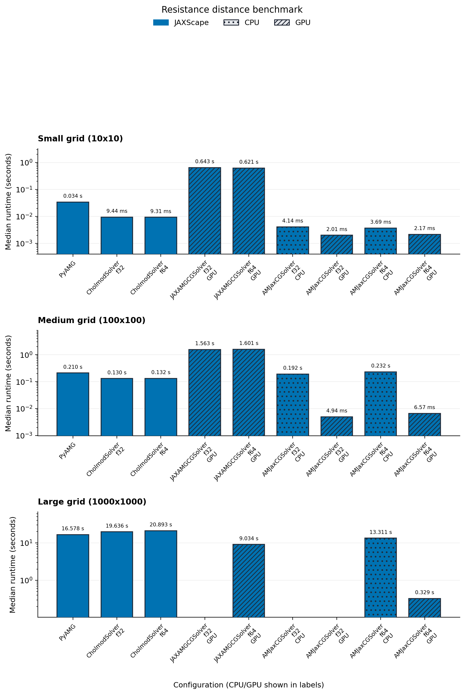
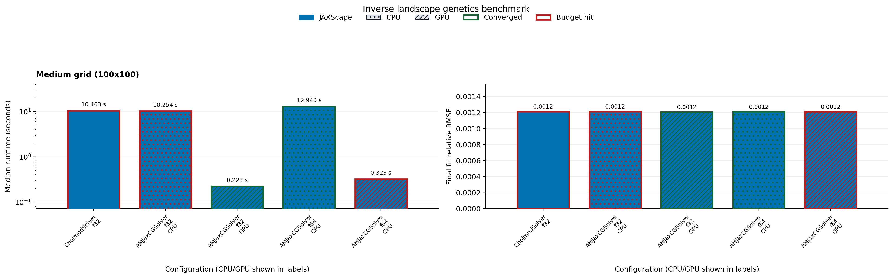

# JAX-AMG benchmark comparison — 14 October 2026

This scoped run contains 44 records: 29 successful, 11 failed, and 4 skipped. It preserves the standard exact and inverse problems and reports the three warmed, synchronized repetitions. The full published comparison and its assets are retained separately. Run logs use Europe/Zurich (UTC+02) local time.

JAX-AMG completed five of six exact runs, with relative RMSE from 0.000151 to
0.000448 against float64 Cholmod. Each successful case was slower than the
matching AMJax GPU profile with a prepared hierarchy. On the largest grid,
JAX-AMG float64 took 9.03 seconds, compared with 0.329 seconds for AMJax on the
GPU and 20.89 seconds for float64 Cholmod on the CPU. The largest JAX-AMG
float32 solve returned non-finite output. Both corrected inverse profiles hit
the 180-second worker limit, so this run cannot establish their final fit
quality or warmed optimization runtime.

## Method and provenance

- Original source: [`9b5a7cbf282a670987c92e9d83d072d331001d46`](https://github.com/vboussange/jaxscape/commit/9b5a7cbf282a670987c92e9d83d072d331001d46); clean working tree at launch.
- Corrected inverse source: [`85c299145148540aabbaaf92cd535e6be9fc3a66`](https://github.com/vboussange/jaxscape/commit/85c299145148540aabbaaf92cd535e6be9fc3a66); clean working tree at launch.
- Hardware: NVIDIA GeForce RTX 3090 (24 GiB), GPU 0 only; driver 580.178.04. Four benchmark CPU threads.
- Native backend: JAX-AMG 0.1.4; unmodified NVIDIA AmgX 2.5.0, revision `cc1cebdbb32b14d33762d4ddabcb2e23c1669f47`; CUDA toolkit 12.9.1 (nvcc 12.9.86), built for sm_86 without MPI.
- Exact resistance: deterministic 10×10, 100×100, and 1000×1000 grids with 20 sites; shared CG `rtol=atol=1e-3`, existing default iteration limit.
- Inverse genetics: standard 100×100 grid and 20 sites; two-parameter monomolecular model, LBFGS with 50 steps and `rtol=atol=1e-5`. The objective uses effective resistance and fit reporting uses the existing commute-distance scale.
- Timing: one unmeasured warm-up, three synchronized repetitions, median seconds. No cold-start, compilation, setup, or separate gradient measurements.
- Watchdog: 180 seconds per JAX worker (existing default); external watchdog explicitly reduced from 1800 to 180 seconds. The limit covers process startup, compilation, warm-up, repeats, and untimed quality checks. A timeout is not a measured runtime or proof that a warmed call itself exceeds 180 seconds.
- AMJax prepares its hierarchy outside timing; inverse optimization freezes that hierarchy while using current CG matrices. JAX-AMG follows upstream-managed refresh, which may refresh on every preconditioner application inside timing. Native hierarchy refresh counts are unspecified.

Installed Python package versions: `jax=0.10.0`, `jaxlib=0.10.0`, `lineax=0.1.0`, `equinox=0.13.6`, `optimistix=0.1.0`, `jaxamg=0.1.4`, `amjax=0.0.3`, `pyamg=5.3.0`, `cholespy=2.2.0`.

Raw artifacts: [JSON](benchmark_results.json), [CSV](benchmark_results.csv), [join manifest](manifest.json), [original run log](original/run.log), [corrected inverse log](inverse-correction/run.log), [GPU/driver](gpu.txt), and [native build recipe and validation](native-build.md). JSON and CSV retain all three timing samples and all existing inverse fit/convergence metrics. The original 44-row
run ([JSON](original/benchmark_results.json), [CSV](original/benchmark_results.csv),
[manifest](original/manifest.json)) exposed a benchmark wiring error in the two JAX-AMG
inverse profiles: a blanket `stop_gradient` map touched a static JAX expression
in solver state. The helper now omits state for JAX-AMG so each solve binds current
values. An untimed compiled-objective regression checks values and gradients in
both dtypes after parameter changes and passed independent verification. Only
the two affected profiles were then rerun with identical settings
([JSON](inverse-correction/benchmark_results.json),
[CSV](inverse-correction/benchmark_results.csv),
[manifest](inverse-correction/manifest.json)). The joined report replaces exactly
those two records; all other 42 records are unchanged. The join manifest records
each row's source and source-artifact hashes; [join_results.py](join_results.py)
rebuilds the joined JSON/CSV. Earlier wiring failures are preserved in the original
run and are not counted as numerical outcomes of the corrected solver.

## Exact resistance

| Solver / backend | 10×10 median (s) | 100×100 median (s) | 1000×1000 median (s) |
| --- | ---: | ---: | ---: |
| JAXScape / PyAMG | 0.0339758 | 0.210431 | 16.5783 |
| JAXScape / CholmodSolver / f32 | 0.00943553 | 0.130426 | 19.6362 |
| JAXScape / CholmodSolver / f64 | 0.00930995 | 0.131641 | 20.8933 |
| JAXScape / AMJaxCGSolver / f32 (CPU) | 0.00413585 | 0.192053 | failed |
| JAXScape / AMJaxCGSolver / f32 (GPU) | 0.00200895 | 0.00494231 | failed |
| JAXScape / AMJaxCGSolver / f64 (CPU) | 0.00369498 | 0.231766 | 13.3107 |
| JAXScape / AMJaxCGSolver / f64 (GPU) | 0.00216841 | 0.00657349 | 0.328926 |
| JAXScape / JAXAMGCGSolver / f32 (GPU) | 0.643102 | 1.56322 | failed |
| JAXScape / JAXAMGCGSolver / f64 (GPU) | 0.621045 | 1.60059 | 9.03376 |
| gdistance / commuteDistance | skipped | skipped | skipped |
| Circuitscape.jl / cg+amg / f64 | failed | failed | failed |
| Circuitscape.jl / cholmod / f64 | failed | failed | failed |



JAX-AMG accuracy is inspected outside timed calls against float64 Cholmod on the same graph and sites. Relative RMSE uses the existing fit-error convention over pairwise distances; the maximum absolute error uses the full distance matrix. Only JAX-AMG exact results receive this extra reference check; baseline timings are otherwise unchanged. These shared loose CG tolerances do not measure the best achievable accuracy of either dtype.

| Grid | JAX-AMG dtype | Relative RMSE | Maximum absolute error |
| --- | --- | ---: | ---: |
| small | float32 | 0.000150555 | 0.000225282 |
| small | float64 | 0.00015058 | 0.000225563 |
| medium | float32 | 0.000366337 | 0.000803133 |
| medium | float64 | 0.000353055 | 0.00073957 |
| large | float32 | — | — |
| large | float64 | 0.000447944 | 0.000972511 |

## Inverse landscape genetics

| Solver / backend | Median (s) | Final relative RMSE | Final commute MSE | Converged | Iterations |
| --- | ---: | ---: | ---: | --- | ---: |
| JAXScape / CholmodSolver / f32 | 10.4634 | 0.00121319 | 492165 | False | 50 |
| JAXScape / AMJaxCGSolver / f32 (CPU) | 10.2541 | 0.00121479 | 493459 | False | 50 |
| JAXScape / AMJaxCGSolver / f32 (GPU) | 0.222635 | 0.00120642 | 486686 | True | 48 |
| JAXScape / AMJaxCGSolver / f64 (CPU) | 12.9404 | 0.00121082 | 490244 | True | 46 |
| JAXScape / AMJaxCGSolver / f64 (GPU) | 0.322924 | 0.00120967 | 489308 | False | 50 |
| JAXScape / JAXAMGCGSolver / f32 (GPU) | failed | — | — | — | — |
| JAXScape / JAXAMGCGSolver / f64 (GPU) | failed | — | — | — | — |
| ResistanceGA | skipped | — | — | — | — |

Both JAX-AMG precisions are absent from this runtime/fit chart because their
corrected workers timed out. The successful baselines have relative RMSE near
0.00121; two converged within the budget and three reached 50 steps.



The charts use the existing scorecard renderer. Failed/unavailable records are listed below and remain in raw data; they do not contribute runtime bars. Fit quality and convergence must be read alongside runtime, and missing fit metrics must not be interpreted as convergence or zero error.

## Failed and unavailable cases

| Case | Tool | Status | Reason |
| --- | --- | --- | --- |
| synthetic_resistance_small | gdistance / commuteDistance | skipped | Install the local R benchmark library with gdistance, raster, sp, and jsonlite to run this adapter. Reported values are rescaled from commute time to effective resistance by dividing by the graph volume. |
| synthetic_resistance_small | Circuitscape.jl / cg+amg / f64 | failed | External tool exited with status 1 while running Circuitscape.jl / cg+amg / f64. |
| synthetic_resistance_small | Circuitscape.jl / cholmod / f64 | failed | External tool exited with status 1 while running Circuitscape.jl / cholmod / f64. |
| synthetic_resistance_medium | gdistance / commuteDistance | skipped | Install the local R benchmark library with gdistance, raster, sp, and jsonlite to run this adapter. Reported values are rescaled from commute time to effective resistance by dividing by the graph volume. |
| synthetic_resistance_medium | Circuitscape.jl / cg+amg / f64 | failed | External tool exited with status 1 while running Circuitscape.jl / cg+amg / f64. |
| synthetic_resistance_medium | Circuitscape.jl / cholmod / f64 | failed | External tool exited with status 1 while running Circuitscape.jl / cholmod / f64. |
| synthetic_resistance_large | JAXScape / AMJaxCGSolver / f32 (CPU) | failed | Solver returned non-finite (NaN/inf) output; full traceback in raw record and log. |
| synthetic_resistance_large | JAXScape / AMJaxCGSolver / f32 (GPU) | failed | Solver returned non-finite (NaN/inf) output; full traceback in raw record and log. |
| synthetic_resistance_large | JAXScape / JAXAMGCGSolver / f32 (GPU) | failed | Solver returned non-finite (NaN/inf) output; full traceback in raw record and log. |
| synthetic_resistance_large | gdistance / commuteDistance | skipped | Install the local R benchmark library with gdistance, raster, sp, and jsonlite to run this adapter. Reported values are rescaled from commute time to effective resistance by dividing by the graph volume. |
| synthetic_resistance_large | Circuitscape.jl / cg+amg / f64 | failed | External tool exited with status 1 while running Circuitscape.jl / cg+amg / f64. |
| synthetic_resistance_large | Circuitscape.jl / cholmod / f64 | failed | External tool exited with status 1 while running Circuitscape.jl / cholmod / f64. |
| synthetic_inverse_medium | JAXScape / JAXAMGCGSolver / f32 (GPU) | failed | Exceeded walltime of 180s while running JAXScape / JAXAMGCGSolver / f32 (GPU). |
| synthetic_inverse_medium | JAXScape / JAXAMGCGSolver / f64 (GPU) | failed | Exceeded walltime of 180s while running JAXScape / JAXAMGCGSolver / f64 (GPU). |
| synthetic_inverse_medium | ResistanceGA | skipped | Install the local R benchmark library with ResistanceGA, raster, and sp to run this adapter. |

Circuitscape failures are missing Julia package dependencies (see the full log). The gdistance and ResistanceGA adapters report their missing R dependencies explicitly. No external comparison is assigned a timing when unavailable.

## Reproduce

Install the versions and native prerequisites above using the linked build recipe and [solver guidance](../../api/linear_solvers.md). Configure `CUDA_HOME`, `AMGX_ROOT`, `AMGX_BUILD`, and runtime library paths for that installation. After correctness checks pass, from the repository root run:

```bash
CUDA_VISIBLE_DEVICES=0 BENCHMARK_THREADS=4 \
  JAXSCAPE_BENCHMARK_EXTERNAL_WALLTIME_SECONDS=180 PYTHONPATH=src \
  python benchmark/jaxamg_comparison.py \
  --output-dir benchmark/results/runs/jaxamg-reproduction
# For only the corrected inverse subset:
CUDA_VISIBLE_DEVICES=0 BENCHMARK_THREADS=4 PYTHONPATH=src \
  python benchmark/jaxamg_comparison.py --task inverse --jaxamg-only \
  --output-dir benchmark/results/runs/jaxamg-inverse-reproduction
CUDA_VISIBLE_DEVICES=0 PYTHONPATH=src python benchmark/render_scorecard.py \
  --results-json benchmark/results/runs/jaxamg-reproduction/benchmark_results.json \
  --output-dir benchmark/results/runs/jaxamg-reproduction/assets
```

The output directory must be new. `--plan` lists the same coverage without executing workloads. The original and corrected invocations and effective overrides are in their respective source manifests. To reproduce the two historical sources exactly, use the original commit for the full run and the corrected commit with `--task inverse --jaxamg-only`. The two figures above were rendered from the linked JSON with the repository renderer; the empty LCP/sensitivity figures from the scoped run are not published. No existing approximate or sensitivity profile was altered.
